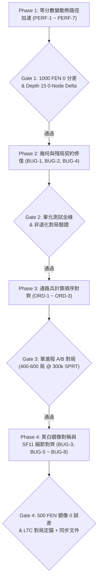

# 經典評估函數 (`evaluation.py`) 深度審計與修復計畫書 (2026-10-31)

> **文檔屬性**：Classical HCE 程式碼全面審計報告與分階段工程實施計畫書（可供團隊傳閱、Code Review 與接續 AI Agent 按步執行）  
> **審計對象**：[`chess_engine/classical/evaluation.py`](evaluation.py)（全檔 1,814 行）及其強耦合模組 [`pawns.py`](pawns.py)、[`endgame.py`](endgame.py)、[`constants.py`](constants.py)、[`tune_eval_match/eval_weights.py`](../../tune_eval_match/eval_weights.py)、[`tuner/codegen/generate_tunable_eval.py`](../../tuner/codegen/generate_tunable_eval.py)  
> **基準 Commit**：`ca0198d`  
> **對照基準**：官方 Stockfish 11（[`stockfish_11/src/evaluate.cpp`](../../stockfish_11/src/evaluate.cpp)、[`pawns.cpp`](../../stockfish_11/src/pawns.cpp)、[`position.cpp`](../../stockfish_11/src/position.cpp)）  
> **關聯主文件**：[`HCE_SF11_GAP_AUDIT.md`](HCE_SF11_GAP_AUDIT.md)、[`SEARCH_EVAL_INTERFACE.md`](SEARCH_EVAL_INTERFACE.md)、[`JIT_COMPILE_CACHE_REPORT.md`](JIT_COMPILE_CACHE_REPORT.md)

---

## 執行摘要 (Executive Summary)

本報告對經典手工評估核心 [`evaluation.py`](evaluation.py) 進行逐行靜態審計與數學反例推導，共識別出 **8 項邏輯／幾何／對齊 BUG**、**3 項計算順序錯誤**（集中於動態通路兵評估），以及 **7 組 Numba `@njit` 熱路徑冗餘計算與記憶體配置瓶頸**。

其中最關鍵的三大高優先級缺陷為：
1. **被牽制皇后（Pinned Queen）攻擊遮罩幾何錯誤（`BUG-1`）**：誤用包含雙軸的 `ROOK_RAYS` / `BISHOP_RAYS` 過濾雙向滑動的皇后，導致非牽制軸上的非法攻擊格洩漏至全盤攻擊表、機動性、威脅與王安全。
2. **純王兵殘局方形法則漏判自阻擋與測試假陽性（`BUG-2`）**：同線疊通路兵會重複領取兩次 `UNSTOPPABLE_PAWN_BONUS`（合計 `+1600 cp`）並無視前兵穿牆雙步；既有單元測試因單兵對照組走進 `_eval_kpk`（`+10119 cp`）而產生假通過。
3. **動態通路兵折半順序顛倒（`ORD-1`）**：先扣除中央直線懲罰 `PassedFile` 使低橫排通路兵變為負分（如 `-48`），隨後對候選／受阻兵執行 `//= 2` 將負分減半為 `-24`，造成**「受阻／候選通路兵在中局反比暢通真通路兵高出 +21 ～ +24 cp」**的反常倒掛。

為避免效能重構與棋力分數變動互相干擾，本計畫書將修復工作拆解為 **4 個獨立驗收階段（Phase 1 ～ Phase 4）**，明確定義每階段的程式碼改動原型、工具鏈同步步驟與量化驗收門檻（0-Node Tree Delta / 單元測試 / SPRT 對局）。

---

## 總覽問題矩陣 (Audit Summary Matrix)

| 編號 | 類別 | 嚴重度 | 模組與行號 | 問題摘要 | 分數變動 | 排入階段 |
| :--- | :---: | :---: | :--- | :--- | :---: | :---: |
| **BUG-1** | 幾何邏輯 | 🔴 高 | [`evaluation.py:846-852, 1056-1062`](evaluation.py#L846-L852) | 被牽制皇后誤用 `ROOK_RAYS`/`BISHOP_RAYS`，保留非牽制方向的非法攻擊格 | 是（修錯） | Phase 2 |
| **BUG-2** | 殘局邏輯 | 🔴 高 | [`evaluation.py:1319-1351`](evaluation.py#L1319-L1351) | 王兵殘局方形法則漏判疊兵／己方王自阻擋（疊兵領 `+1600 cp`）；單元測試假陽性 | 是（修錯） | Phase 2 |
| **BUG-3** | 對稱性 | 🟠 中 | [`evaluation.py:562, 1690-1798`](evaluation.py#L1795-L1798) | 有號分數使用向下取整 `//` 而非向零截斷，造成全盤黑白鏡像系統性偏袒黑方 1～2 cp | 是（±1~2 cp） | Phase 4 |
| **BUG-4** | 權重接線 | 🟠 中 | [`evaluation.py:501, 1316, 1454, 1608`](evaluation.py#L501) | `EG_SAFETY_SCALE=0.96` 實質死碼；特化殘局、王兵殘局、空間評估與 `eval_weights` 脫鉤 | 視模式 | Phase 2 |
| **BUG-5** | SF11 對齊 | 🟡 低–中 | [`evaluation.py:1183-1193`](evaluation.py#L1183-L1193) | `ThreatByKing` 誤乘 `popcount`（王一回合僅能吃一子，SF11 為布林觸發一次） | 是 | Phase 4 |
| **BUG-6** | SF11 對齊 | 🟡 低–中 | [`evaluation.py:710, 759, 918, 968`](evaluation.py#L710) | `MinorBehindPawn` 僅檢查己方兵，漏計敵兵正後方的掩體／封鎖哨站格 | 是 | Phase 4 |
| **BUG-7** | SF11 對齊 | 🟡 低–中 | [`evaluation.py:870-890, 1080-1100`](evaluation.py#L870-L890) | `WeakQueen` 未排除同線重疊的敵方狙擊子（Snipers），雙車／雙象疊線誤觸懲罰 | 是 | Phase 4 |
| **BUG-8** | SF11 對齊 | 🟡 低–中 | [`evaluation.py:719, 779, 837, 867...`](evaluation.py#L716-L719) | `kingAttacksCount` 置於 `if att & enemy_king_zone:` 外，誤計雙兵保護剔除格並浪費 `POPCNT` | 微幅 | Phase 4 |
| **ORD-1** | 計算順序 | 🔴 高 | [`evaluation.py:184-233, 266-315`](evaluation.py#L184-L233) | `evaluate_passed_pawns` 先扣 `PassedFile` 再 `//= 2`，負分減半使受阻兵高出真通路兵 +24 cp | 是（關鍵） | Phase 3 |
| **ORD-2** | 計算順序 | 🟠 中 | [`evaluation.py:237-253, 319-335`](evaluation.py#L237-L253) | `evaluate_passed_pawns` 國王距離獎懲在 `//= 2` 之後才累加，候選／受阻兵未折半 | 是 | Phase 3 |
| **ORD-3** | 門檻順序 | 🟠 中 | [`evaluation.py:192, 238, 274, 320`](evaluation.py#L192) | 通路兵自由推進用 `rank > 2`，國王距離卻用 `rank > 3`，漏計第 4 橫排王距離（`w = +2`） | 是 | Phase 3 |
| **PERF-1** | 記憶體/快取 | 🔴 高 | [`evaluation.py:1358-1375`](evaluation.py#L1358-L1375) | 王兵殘局熱路徑呼叫 `np.zeros(3)` 觸發堆分配，且繞過 Pawn Hash 白算 6 次王翼兵盾 | **0（純加速）** | Phase 1 |
| **PERF-2** | 重複計算 | 🟠 中 | [`evaluation.py:1608, 1638, 1793`](evaluation.py#L1638-L1650) | 單次完整評估跨 `endgame.py` 與 `evaluation.py` 重複 3 次全盤 `count_bits`（30 次 `POPCNT`） | **0（純加速）** | Phase 1 |
| **PERF-3** | 迴圈不變量 | 🟠 中 | [`evaluation.py:768-795, 977-1005`](evaluation.py#L768-L795) | 主教迴圈內重算盤面不變量，且對全 64 格無條件跑第 2 次 `get_bishop_attacks` | **0（純加速）** | Phase 1 |
| **PERF-4** | 重複計算 | 🟠 中 | [`evaluation.py:1449-1510`](evaluation.py#L1449-L1510) | `evaluate_space` 重算 `npm`、每次執行期查 10 次陣列組裝固定常數遮罩 | **0（純加速）** | Phase 1 |
| **PERF-5** | 空轉迴圈 | 🟡 低–中 | [`evaluation.py:1150-1180`](evaluation.py#L1150-L1180) | `ThreatByMinor`/`ThreatByRook` 無威脅時仍空轉 24 次迴圈，且迭代恆為 0 的 `pt=5`（王） | **0（純加速）** | Phase 1 |
| **PERF-6** | 死碼/重算 | 🟡 低 | [`evaluation.py:656-1236`](evaluation.py#L656) | 死變數 `white/black_minor_attacks`；`ThreatByPawnPush` 重算已存在的 `white_safe`/`black_safe` | **0（純加速）** | Phase 1 |
| **PERF-7** | 冗餘分支 | 🟡 低 | [`evaluation.py:213, 453, 1716, 1782`](evaluation.py#L1716) | 恆真 `if not lazy:`、`if block_sq < 64:`、重複計算 `w`、跨 `@njit` 傳遞未使用參數 | **0（純加速）** | Phase 1 |

---

## 第一部分：確認的 BUG 深度診斷與修復規格

### 🔴 BUG-1：被牽制皇后（Pinned Queen）攻擊遮罩幾何錯誤【✅ 已修復驗證】

* **位置**：[`evaluation.py:737, 791, 829, 938, 991, 1029`](evaluation.py#L829)（象、車、后 6 個迴圈）
* **現行程式碼（修復後）**：
  ```python
  if pinned_white & sq_bb:
      att &= LINE_BB[white_king_sq, sq]
  ```
* **驗證結果**：
  * 新增專屬幾何單元測試 [`tests/test_pinned_eval_geometry.py`](../../tests/test_pinned_eval_geometry.py) 4 項測試全數通過（覆蓋白/黑方正交直線牽制不漏洩斜向攻擊格、斜線牽制不漏洩正交攻擊格）。
  * 重新生成 [`tuner/tunable_eval.py`](../../tuner/tunable_eval.py) 並以 [`tests/test_tunable_eval_parity.py`](../../tests/test_tunable_eval_parity.py) 驗證 classical 與 tunable eval 100% 保持完全一致。
* **問題根因與具體反例**：
  [`ROOK_RAYS[king_sq]`](bitboard_utils.py#L178-L185) 同時包含王所在的**橫排與直線**；[`BISHOP_RAYS[king_sq]`](bitboard_utils.py#L186-L195) 同時包含王所在的**兩條正反對角線**。主教與車僅單一類型移動，與王共軸時不會跨到垂直軸；但**皇后兼具直線與斜線攻擊**，其非牽制方向的攻擊射線必然與王的另一條軸相交：
  1. **直線牽制反例**：白 `Ke1`、`Qe3`，黑 `Re8`（`Qe3` 被嚴格釘死在 e 直線 `e2-e8`）。`get_queen_attacks(e3)` 產生的斜線攻擊包含 `c1` 與 `g1`。由於 `c1`、`g1` 位於第 1 橫排（屬於 `ROOK_RAYS[e1]`），`att &= ROOK_RAYS[e1]` **錯誤保留了 `c1` 與 `g1` 兩個完全非法的攻擊格**！
  2. **斜線牽制反例**：白 `Ke1`、`Qg3`，黑 `Bh4`（`Qg3` 被嚴格釘死在 `e1-h4` 對角線）。`get_queen_attacks(g3)` 的第 3 橫排攻擊包含 `c3`。由於 `c3` 剛好落在通過 `e1` 的另一條對角線 `e1-a5`（屬於 `BISHOP_RAYS[e1]`），`att &= BISHOP_RAYS[e1]` **錯誤保留了非法格 `c3`**！
* **連鎖影響**：非法攻擊格直接混入 `white_attacks`、`white_attacks2`、`white_queen_attacks`，同時污染機動性（Mobility）、雙重攻擊判定、威脅（Threats）與敵王安全（King Danger `queen_check` / `weak` 防守判定）。
* **SF11 對照與標準修法**：
  SF11（[`evaluate.cpp:273-274`](../../stockfish_11/src/evaluate.cpp#L273-L274)）統一使用通過兩點的唯一共線遮罩 `b &= LineBB[ksq][s]`。本專案 [`bitboard_utils.py:210`](bitboard_utils.py#L210) 已預先建好 `LINE_BB`（`64×64 uint64` = 32 KiB，遠低於 Numba 1 MB 快取上限）。可將象／車／后共 **6 個迴圈**的多分支判斷統一替換為單行查表：
  ```python
  if pinned_white & sq_bb:
      att &= LINE_BB[white_king_sq, sq]
  ```
  > [!IMPORTANT]
  > 修改 `evaluation.py` 匯入 `LINE_BB` 時，**必須同步**將 `LINE_BB` 加入 [`tuner/codegen/generate_tunable_eval.py:250-253`](../../tuner/codegen/generate_tunable_eval.py#L250-L253) 的固定 `header` 匯入清單，否則重新生成 `tunable_eval.py` 時會發生 `NameError`。

---

### 🔴 BUG-2：純王兵殘局方形法則漏判「疊兵／己方王自阻擋」與測試假陽性

* **位置**：[`evaluation.py:1319-1331`](evaluation.py#L1319-L1331)（白兵）、[`evaluation.py:1339-1351`](evaluation.py#L1339-L1351)（黑兵）
* **現行程式碼**：
  ```python
  if not (WHITE_PASSED_PAWN_MASKS[sq] & black_pawns):
      rank = sq // 8
      steps_to_promote = 7 - rank
      if rank == 1:
          steps_to_promote = 5  # double-push correction
      promotion_sq = (sq % 8) + 56
      king_dist = CHEBYSHEV_DISTANCE[black_king_sq, promotion_sq]
      adjusted_pawn_steps = steps_to_promote
      if side_to_move == 1:
          adjusted_pawn_steps += 1
      if king_dist > adjusted_pawn_steps:
          score += UNSTOPPABLE_PAWN_BONUS
  ```
* **問題根因與具體反例**：
  1. **疊通路兵雙重領賞 + 穿牆雙步**：在局面 `7k/7p/8/8/8/P7/P7/7K w - - 0 1`（白 `Pa3` + `Pa2` 疊兵）中，`a3` 與 `a2` 的 `WHITE_PASSED_PAWN_MASKS[sq] & black_pawns` 皆為 `0`。結果兩兵**同時領取 `+800 cp`（合計 `+1600 cp`）**，且 `a2`（`rank == 1`）無視正前方 `a3` 的阻擋，直接套用雙步推進 `steps_to_promote = 5`！
  2. **己方王位於升變路徑上的自阻擋**：例如白 `Pa4`、白王在 `a5`、黑王在 `e5`（輪黑走），白方必須先花 1 步移開 `Ka5` 才能推兵，真實升變需 5 步而非 4 步，黑王完全來得及進入方形區攔截，但現行公式未對路徑上的己方王加計繞行步數（亦未檢查 `rank == 1` 時 `sq + 8` 與 `sq + 16` 是否被己方王佔據）。
  3. **既有單元測試假陽性剖析**：[`tests/test_endgame_conformance.py:233-244`](../../tests/test_endgame_conformance.py#L233-L244)（`test_doubled_pawns_front_blocks_rear_unstoppable`）之所以通過，是因為其對照組 `fen_single = "7k/8/8/8/8/P7/8/7K w - - 0 1"` 只有單兵，在 `_evaluate_position_jit:1608` 直接命中特化 KPK 位元庫並回傳 **`+10119 cp`**，導致 `diff = ~1834 - 10119 = -8285 < 500` 而誤判通過！對照組必須在另一翼放一顆無關敵兵（如 `7k/7p/...`）才能真正測試 `_evaluate_king_pawn_endgame`。
* **標準修法（遵守 `HCE_SF11_GAP_AUDIT.md` §12 禁令）**：
  * **嚴禁**恢復已回滾的 P3b「全盤僅競速最快單兵可領賞」邏輯。
  * 僅補齊同直線前方的自阻擋幾何條件：
    ```python
    forward_mask = WHITE_FORWARD_FILE_MASKS[sq]
    # 1. 前方無敵兵/敵防線（passed）且同線前方無己方兵（排除疊兵後兵，與 pawns.py 定義一致）
    if (WHITE_PASSED_PAWN_MASKS[sq] & black_pawns) == 0 and (forward_mask & white_pawns) == 0:
        rank = sq >> 3
        king_on_path = (forward_mask & piece_bbs[5]) != 0
        steps_to_promote = 7 - rank
        # 2. 起點雙步必須 a3 (sq+8) 與 a4 (sq+16) 皆無任何棋子阻擋
        if rank == 1 and ((all_occ & (BB_SQUARES[sq + 8] | BB_SQUARES[sq + 16])) == 0):
            steps_to_promote = 5
        # 3. 己方王擋在升變直線上，至少需多花 1 步讓路
        if king_on_path:
            steps_to_promote += 1
        promotion_sq = (sq & 7) + 56
        king_dist = CHEBYSHEV_DISTANCE[black_king_sq, promotion_sq]
        adjusted_pawn_steps = steps_to_promote + (1 if side_to_move == 1 else 0)
        if king_dist > adjusted_pawn_steps:
            score += UNSTOPPABLE_PAWN_BONUS
    ```

---

### 🟠 BUG-3：有號分數使用向下取整 `//` 造成全盤黑白鏡像不對稱

* **位置**：
  * Tapered 階段混合與縮放：[`evaluation.py:1690-1693`](evaluation.py#L1690-L1693)、[`1721-1724`](evaluation.py#L1721-L1724)、[`1795-1798`](evaluation.py#L1795-L1798)
  * 動態 Lazy 門檻均值：[`evaluation.py:1717`](evaluation.py#L1717) `v = (mg_score + eg_score) // 2`
  * 王安全殘局縮放：[`evaluation.py:562`](evaluation.py#L562) `eg_safety_score = ((white_eg_score - black_eg_score) * eg_safe_scale) // np.int32(100)`
* **問題根因與數學反例**：
  在 C++（[`evaluate.cpp:817-820`](../../stockfish_11/src/evaluate.cpp#L817-L820)）中，有號整數除法 `/` **向零截斷（Truncate toward zero）**，滿足奇函數性質 $f(-x) = -f(x)$；但在 Python 與 Numba 中，`//` 為 **向負無窮向下取整（Floor division）**：
  * **反例 1（Tapered Blend 偏袒黑方）**：設白方微小優勢 `mg_score = +1, eg_score = 0, phase = 64`，白視角 `final_score = 64 // 128 = 0`。將棋盤完全黑白上下翻轉（Color Flip）後，`mg_score = -1, eg_score = 0, phase = 64`，卻得到 `final_score = -64 // 128 = -1`（黑方憑空多得 `+1 cp`）。若同時觸發 `sf != 64`，`eg_score * sf // 64` 先向下取整一次，`// 128` 再向下取整第二次，黑白鏡像落差可達 **`2 cp`**。
  * **反例 2（Lazy Early-Exit 分支不對稱）**：當 `mg_score + eg_score = +2201`（`npm = 0`）時，`+2201 // 2 = 1100`（未超過門檻 `1100`，繼續執行完整評估）；而完全對稱的黑優局面 `-2201 // 2 = -1101`，`abs(-1101) > 1100` 卻直接觸發 Lazy 提早退出！
* **標準修法**：
  定義 `@numba.njit(inline='always')` 向零截斷輔助函式（當除數 `d > 0` 為正整數時）：
  ```python
  @numba.njit(numba.int32(numba.int32, numba.int32), cache=True, inline='always')
  def _trunc_div(n, d):
      return np.int32(int(n / d)) if False else (n // d if n >= 0 else -((-n) // d))
  ```
  （註：在 Numba `nopython` 下，`n // d if n >= 0 else -((-n) // d)` 會編譯為無分支 `cmov` 整數指令，無浮點轉型誤差且完全符合 C++ `/` 語義。）

---

### 🟠 BUG-4：`EG_SAFETY_SCALE` 實質死碼與 `SearchContext.eval_weights` 脫鉤

* **位置與四處脫鉤明細**：
  1. **`EG_SAFETY_SCALE = 0.96` 從未生效**：[`constants.py:375`](constants.py#L375) 記載 Match-SPSA Block A 調優值 `EG_SAFETY_SCALE = 0.96`，但 [`evaluation.py:501`](evaluation.py#L501) 寫死預設值 `np.int32(100)`，且 [`tune_eval_match/eval_weights.py:208`](../../tune_eval_match/eval_weights.py#L208) 也寫死 `w[EW_EG_SAFETY_SCALE] = 100`。無論是否傳入 `search_context`，實際倍率永遠是 `100%` 而非 `96%`。
  2. **特化殘局忽略 Runtime 材質權重**：[`_evaluate_position_jit:1608-1614`](evaluation.py#L1608-L1614) 呼叫 `evaluate_special_endgame_with_material` 時直接傳入常數 `MG_MATERIAL_VALUES[0..4]` / `EG_MATERIAL_VALUES[0..4]`，未使用 `_material_mg_eg(..., ew, use_ew)`，導致 `tune_eval_match --block material` 對局調參時 KRKP/KQKP/KQKR 等殘局材質與主評估不一致。
  3. **純王兵殘局忽略 Runtime 權重**：[`_evaluate_king_pawn_endgame:1316-1380`](evaluation.py#L1316-L1380) 未接收 `ew, use_ew`，硬編碼 `EG_MATERIAL_VALUES[0]` 與 `_DUMMY_EW, False`。
  4. **空間評估忽略 Runtime 材質權重**：[`evaluate_space:1454-1463`](evaluation.py#L1454-L1463) 硬編碼 `MG_MATERIAL_VALUES[1..4]` 重算非兵材質，未直接使用外部已依 `ew` 算妥的 `npm`。

---

### 🟡 BUG-5 ～ BUG-8：Stockfish 11 細節語義對齊差異

1. **BUG-5：`ThreatByKing` 重複乘上 `popcount`**（[`evaluation.py:1183-1193`](evaluation.py#L1183-L1193)）
   * **問題**：`mg_threats += THREAT_BY_KING[0] * count`。國王一回合只能吃一顆棋子，且多顆無根子同時受攻的懲罰已由下方的 `THREAT_HANGING` 按 `count_bits` 線性累加。SF11（[`evaluate.cpp:514-515`](../../stockfish_11/src/evaluate.cpp#L514-L515)）為 `if (weak & attackedBy[Us][KING]) score += ThreatByKing;`（布林觸發一次，不乘 `count`）。
2. **BUG-6：`MinorBehindPawn` 漏計敵兵正後方掩體格**（[`evaluation.py:710, 759, 918, 968`](evaluation.py#L710)）
   * **問題**：目前僅檢查 `wp_bb & BB_SQUARES[sq + 8]`（己方兵）。SF11（[`evaluate.cpp:302`](../../stockfish_11/src/evaluate.cpp#L302) `shift<Down>(pos.pieces(PAWN))`）檢查的是**雙方所有兵** `(wp_bb | bp_bb)`——因為騎士或主教躲在**敵兵正後方**（如白馬在 `d5`、黑兵在 `d6`）同樣享有免受敵方正面車重子直擊的天然掩體（Nimzowitsch 封鎖格）。
3. **BUG-7：`WeakQueen` 未排除同線重疊狙擊子（Snipers）**（[`evaluation.py:870-890, 1080-1100`](evaluation.py#L870-L890)）
   * **問題**：計算 `blockers_between = between & all_occupancy` 時未如 SF11 `slider_blockers`（[`position.cpp:458`](../../stockfish_11/src/position.cpp#L458) `occupied ^ snipers`）先剔除同線上的其他敵方狙擊子。
   * **反例**：白 `Qd1` 面對黑雙車疊在 d 線 `Rd5` + `Rd8`（`d2-d4` 皆空）。此時 `Qd1` 正面直接對峙黑車，並不存在任何「被牽制子／閃擊隱患」，但迴圈檢查 `Rd8` 時會把前方的 `Rd5` 算作 `count_bits(blockers_between) == 1`，錯誤對白后扣罰 `WEAK_QUEEN`（`-12 MG, -2 EG`）。只需將遮罩改為 `between & (all_occupancy ^ rook_pinners)`（象同理 `^ bishop_pinners`）即可精確修復。
4. **BUG-8：`kingAttacksCount` 置於 `if att & enemy_king_zone:` 之外**（[`evaluation.py:719, 779, 837, 867, 927, 988, 1047, 1077`](evaluation.py#L716-L719)）
   * **問題**：SF11（[`evaluate.cpp:280-285`](../../stockfish_11/src/evaluate.cpp#L280-L285)）僅在棋子觸發 `if (b & kingRing[Them])` 時才累加 `kingAttacksCount += popcount(b & attackedBy[Them][KING])`。目前放在 `if` 之外，除了對每顆未參與攻王的棋子多做一次無謂的 `POPCNT`，當棋子僅擦過「被雙兵保護而從 `king_zone` 剔除的王鄰格」時，也會誤加 `kingAttacksCount`。

---

## 第二部分：計算順序錯誤深度剖析 (Order-of-Evaluation Bugs)

### 🔴 ORD-1 ～ ORD-3：`evaluate_passed_pawns` 候選／受阻兵折半順序顛倒

* **位置**：[`evaluation.py:182-253`](evaluation.py#L182-L253)（白方）、[`evaluation.py:264-335`](evaluation.py#L264-L335)（黑方），對照 SF11 [`evaluate.cpp:596-644`](../../stockfish_11/src/evaluate.cpp#L596-L644)
* **三處順序與門檻錯位對照**：

| 步驟 | 現行 `evaluation.py` 順序 | Stockfish 11 (`evaluate.cpp:596-644`) 標準順序 | 現行錯誤後果 |
| :--- | :--- | :--- | :--- |
| **1. 基礎分** | `p_bonus = PASSED_PAWN_BONUS[r]` | `bonus = PassedRank[r]` | 一致 |
| **2. 直線懲罰** | ❌ **先執行** `p_bonus -= PassedFile * edge_dist` | （留到最後第 6 步執行，不參與折半） | 低橫排中央兵 `p_bonus_mg` 變成**負數**（`-48`） |
| **3. 自由推進** | `if not is_blocked and r > 2: p_bonus += k * w` | `if (r > RANK_3 && !blocked) bonus += k * w` | 一致 |
| **4. 國王距離** | ❌ 延後到第 6 步，且門檻寫成 **`r > 3`** | ✅ **在此處累加進 `bonus`**，門檻同為 **`r > RANK_3` (`r > 2`)** | 第 4 橫排漏算王距離；候選／受阻兵的王距離未被折半 |
| **5. 候選／受阻折半** | `if not next_passed or any_pawn_ahead: p_bonus //= 2` | `if (!next_passed || pawn_ahead) bonus = bonus / 2` | ❌ **把第 2 步產生的負分減半，變成倒貼 `+24 cp` 獎賞！** |
| **6. 收尾** | 累加 `proximity_bonus`（未折半） | ✅ **最後才扣** `bonus - PassedFile * edge_dist` | — |

* **具體數值驗算反例（中局 d3 / d4 兵，`edge_dist = 3`，`file_mg = 16`）**：
  * **案例 A：白方真通路兵在 `d3`（`rank = 2`），前方 `d4` 被黑馬封鎖，但無敵兵防守前格（`next_passed = True, any_pawn_ahead = False`）**：
    * `p_bonus_mg = 0 - 16 * 3 = -48`（不觸發折半）→ **實得 `-48 cp`（MG）**。
  * **案例 B：白方在 `d3` 只是受敵兵牽制的「候選通路兵」（例如黑兵在 `e5` 控制 `d4`，`next_passed = False`），或是 `d3+d4` 劣質疊兵的後兵（`any_pawn_ahead = True`）**：
    * `p_bonus_mg = 0 - 16 * 3 = -48` → 觸發 `p_bonus_mg //= 2` → **實得 `-24 cp`（MG）**！
  * **荒謬結論**：結構更差的「候選通路兵」或「疊兵後兵」，在中局反而比真正的暢通通路兵**高出 `+24 cp`**（在 `d4` 受阻時亦高出 `+21 cp`）！這會直接誘導搜尋在開中局刻意保留受阻候選兵或製造疊兵，抗拒走成真通路兵。

* **標準修復結構（白方示意，黑方完全對稱）**：
  ```python
  p_bonus_mg, p_bonus_eg = _passed_rank_bonus(rank, ew, use_ew)

  if rank > 2:
      w = np.int32(dyn_mult * rank + dyn_off)

      # 1. King proximity (accumulated into p_bonus_eg BEFORE candidate halving)
      dist_friendly = min(CHEBYSHEV_DISTANCE[white_king_sq, block_sq], KING_PROXIMITY_MAX_DIST)
      dist_enemy = min(CHEBYSHEV_DISTANCE[black_king_sq, block_sq], KING_PROXIMITY_MAX_DIST)
      proximity_bonus = ((dist_enemy * prox_en) // prox_en_div - dist_friendly * prox_fr) * w
      if (block_sq >> 3) != 7:
          dist_friendly_2nd = min(CHEBYSHEV_DISTANCE[white_king_sq, block_sq + 8], KING_PROXIMITY_MAX_DIST)
          proximity_bonus -= dist_friendly_2nd * w
      p_bonus_eg += max(KING_PROX_MIN_BONUS, min(KING_PROX_MAX_BONUS, proximity_bonus))

      # 2. Free-path push dynamics
      if not is_blocked:
          # ... (compute k as before) ...
          dynamic_bonus = k * w
          p_bonus_mg += dynamic_bonus
          p_bonus_eg += dynamic_bonus

  # 3. Phalanx / Connected passed pawn bonuses
  if (white_pawns & PHALANX_MASK[sq]) != np.uint64(0):
      p_bonus_mg += PASSED_PHALANX_BONUS[rank]
      p_bonus_eg += PASSED_PHALANX_BONUS[rank]
  elif (white_pawns & WHITE_SUPPORT_MASK[sq]) != np.uint64(0):
      p_bonus_mg += PASSED_CONNECTED_BONUS[rank]
      p_bonus_eg += PASSED_CONNECTED_BONUS[rank]

  # 4. Candidate / pawn-blocked halving BEFORE subtracting PassedFile
  if rank < 7:
      next_sq = sq + 8
      next_passed = (black_pawns & WHITE_PASSED_PAWN_MASKS[next_sq]) == np.uint64(0)
      any_pawn_ahead = (all_pawns & BB_SQUARES[next_sq]) != np.uint64(0)
      if not next_passed or any_pawn_ahead:
          p_bonus_mg = _trunc_div(p_bonus_mg, cand_div)
          p_bonus_eg = _trunc_div(p_bonus_eg, cand_div)

  # 5. Subtract PassedFile LAST (matches SF11 evaluate.cpp:644)
  edge_dist = np.int32(min(file_idx, 7 - file_idx))
  p_bonus_mg -= file_mg * edge_dist
  p_bonus_eg -= file_eg * edge_dist
  ```

---

### ✅ 主幹管道順序驗證（`_evaluate_position_jit` 確認無誤）

對 [`_evaluate_position_jit:1603-1808`](evaluation.py#L1603-L1808) 的跨函數資料流審計結果為**依賴順序完全正確**：


* 所有攻擊位元板、`pinned_white/black`、`mg_mobility_pure` 均在 `evaluate_attacks_mobility_threats` 完整產出後才交由 `evaluate_passed_pawns`、`evaluate_king_safety` 與 `evaluate_space` 使用。
* `_compute_initiative` 嚴格位於所有子項目累加完畢之後、`get_endgame_scale_factor` 之前。
* 兩處 Lazy 提前返回皆呼叫 `get_endgame_scale_factor`，此為 2026-10-16 修復要塞殘局 TT 污染的關鍵護欄（見 [`HCE_SF11_GAP_AUDIT.md:425-434`](HCE_SF11_GAP_AUDIT.md#L425-L434)），**必須完整保留**。

---

## 第三部分：冗餘計算與 Numba 熱路徑效能瓶頸 (Zero-Eval-Delta Optimizations)

以下 7 項優化**完全不改變任何局面的評估分數（Bit-Exact 0 分差）**，純粹消除熱路徑記憶體分配與重複位元運算：

1. **PERF-1：消除 `_evaluate_king_pawn_endgame` 的 NRT 堆分配並接入 Pawn Hash**（[`evaluation.py:1358-1375, 1626`](evaluation.py#L1358-L1375)）
   * **問題**：`occ_bbs = np.zeros(3, dtype=np.uint64)`（L1371）在每次評估王兵殘局時向 Numba NRT 申請並釋放堆記憶體，而呼叫端 `_evaluate_position_jit` 本就持有最新的 `occupancy_bbs`！此外 L1358 呼叫未快取的 `evaluate_pawn_structure`，放棄了深層殘局搜尋 >99% 命中率的 Pawn Hash，且每次白算最多 6 次王翼兵盾 `evaluate_shelter_aligned` 後直接丟棄 `res[2..5]`。
   * **修法**：直接傳入 `occupancy_bbs` 與 `search_context`；當 `search_context is not None` 時改呼叫 `evaluate_pawn_structure_cached`（回傳元組之 `eg_pawn_structure`、`w_passed`、`b_passed` 與未快取版 100% 恆等）。

2. **PERF-2：消除單次評估跨模組重複 3 次的全盤 `count_bits` 與王格查找**
   * **問題**：在一次常規評估中，[`evaluate_special_endgame_with_material`](endgame.py#L522-L532)、[`_process_piece_score_and_count`](evaluation.py#L1638-L1650) 與 [`get_endgame_scale_factor`](endgame.py#L645-L655) 分別對 10 個棋種位元棋盤各跑一次 `count_bits`（合計 30 次 `POPCNT`），且雙王 `get_lsb_index` 亦重複執行 3～4 次。
   * **修法**：先在 `_evaluate_position_jit` 頂部完成一次 `piece_counts` 與 `white_king_sq` / `black_king_sq` 提取（或為 `endgame.py` 提供接受預先算好 `piece_counts` 的內部入口），將 20 次冗餘 `POPCNT` 降為 0。

3. **PERF-3：外提主教迴圈不變量 + 大對角線遮罩過濾二次 Magic 查表**（[`evaluation.py:768-795, 977-1005`](evaluation.py#L768-L795)）
   * **問題**：
     * `blocked_w = wp_bb & (all_occupancy >> 8)`、`center_blocked`、`multiplier`、`pawn_only_occ = wp_bb | bp_bb` 與單顆主教位置 `sq` 完全無關，卻在 `while temp_bb:` 迴圈內每隻象重算一次。
     * `LongDiagonalBishop` 對站在任何格子上的主教都無條件執行第二次 `get_bishop_attacks(sq, pawn_only_occ) & CENTER_SQUARES`；但幾何上，只有站在**兩條大對角線非中心 12 格**（`a1, b2, c3, f6, g7, h8, a8, b7, c6, f3, g2, h1`，遮罩 `0x8142240000244281`）的主教才可能同時攻擊 2 個中心格！
   * **修法**：將不變量外提至 `if wb_bb:` / `if bb_bb:` 區塊一次算完，並加上 `if sq_bb & np.uint64(0x8142240000244281):` 守衛，省下 ~81% 的二次 Magic Bitboard 查表。

4. **PERF-4：簡化 `evaluate_space` 傳參與編譯期常數空間遮罩**（[`evaluation.py:1449-1510`](evaluation.py#L1449-L1510)）
   * **修法**：直接傳入外部已算好的 `npm`（省去 8 次乘法與陣列讀取），移除未使用的 `occupancy_bbs` 參數，並將每次執行 10 次 `FILE_MASKS`/`RANK_MASKS` 查表的 `white_space_mask` / `black_space_mask` 替換為常數 `np.uint64(0x000000003C3C3C00)` 與 `np.uint64(0x003C3C3C00000000)`。

5. **PERF-5：`ThreatByMinor` / `ThreatByRook` 防空轉守衛與移除 `pt = 5` 恆零迭代**（[`evaluation.py:1150-1180`](evaluation.py#L1150-L1180)）
   * **修法**：外層加上 `if w_minor_threatens:` / `if b_minor_threatens:` / `if w_rook_threatens:` / `if b_rook_threatens:`（安靜局面直接跳過全部 4 個迴圈），並將 `range(6)` 縮減為 `range(5)`（`black_weak` 與 `black_defended` 已排除國王，`pt = 5` 數學上恆為 `0`）。

6. **PERF-6：移除死變數 `white/black_minor_attacks` 並重用 `white_safe` / `black_safe`**
   * 移除 [`evaluation.py:656, 666, 698, 747, 906, 956`](evaluation.py#L656) 從未讀取的 `white_minor_attacks` 與 `black_minor_attacks`。
   * 將 [`evaluation.py:1226, 1236`](evaluation.py#L1226) `ThreatByPawnPush` 中的 `(~black_attacks | white_attacks)` 與 `(~white_attacks | black_attacks)` 直接替換為 L1127、L1136 已算好的 `white_safe` 與 `black_safe`。

7. **PERF-7：清除恆真條件、重複純量與無用跨函數參數**
   * 移除 [`evaluation.py:1716, 1782`](evaluation.py#L1716) 恆為 `True` 的 `if not lazy:`（L1687 已 `if lazy: return`）。
   * 移除 [`evaluation.py:237, 319`](evaluation.py#L237) 恆為 `True` 的 `if block_sq < 64:` / `if block_sq >= 0:`，並合併同一迴圈內重算兩次的 `w = np.int32(dyn_mult * rank + dyn_off)`。
   * 移除 [`evaluate_king_safety:453-454`](evaluation.py#L453-L454) 從未使用的 `game_state` 與 `piece_counts` 參數，縮減 `@njit` 呼叫簽章。
   * 註：`KING_PROTECTOR` 在 `constants.py:453` 雖為 `[0, 0]`，但因 [`tuner/parameters.py`](../../tuner/parameters.py) 與 [`generate_tunable_eval.py`](../../tuner/codegen/generate_tunable_eval.py) 會透過正則將 `KING_PROTECTOR[0]` 改寫為 `get_array_val(theta, IDX_KING_PROTECTOR, 0)`，**必須保留該運算式名稱**或加 `if KING_PROTECTOR[0] != 0 or KING_PROTECTOR[1] != 0:` 以維持 Texel Tuner 100% 相容。

---

## 第四部分：工程護欄與工具鏈耦合約束 (Mandatory Guardrails)

任何執行本計畫的開發者或 AI Agent **必須嚴格遵守**以下四條專案不變量：

> [!CAUTION]
> **護欄 1：`search.py` 牽制遮罩回傳契約不可更改**  
> `_evaluate_position_jit` 回傳的 `(val, pinned_white, pinned_black)` 直接供 [`search.py`](search.py) 進行著法合法性快速過濾：
> 1. `pinned_white` / `pinned_black` **必須僅包含己方被絕對牽制的棋子**（不可混入敵方閃將阻擋子）。
> 2. 所有提前返回分支（特化殘局、純王兵殘局、顯式／動態 Lazy 出口）**必須回傳 `PINNED_UNCOMPUTED_SENTINEL`（`0xFFFFFFFFFFFFFFFF`）**，絕不可回傳 `0`。

> [!WARNING]
> **護欄 2：`tuner/tunable_eval.py` 自動生成管線同步**  
> 每次修改 [`evaluation.py`](evaluation.py)、[`pawns.py`](pawns.py) 或 [`material.py`](material.py) 後，**必須執行**：
> ```bash
> python -m tuner.codegen.generate_tunable_eval
> python -m unittest tests.test_tunable_eval_parity
> ```
> 注意 [`generate_tunable_eval.py`](../../tuner/codegen/generate_tunable_eval.py) 的三項耦合機制：
> 1. **固定 Header 匯入（L248–260）**：原始 `evaluation.py` 的 `import` 區塊會被剝除，若新增匯入符號（如 `LINE_BB`），必須同步寫入 `generate_tunable_eval.py` 的 `header`。
> 2. **`theta` 參數自動注入清單（L284–302）**：若新增或改名內部讀取評估常數的 `@njit` 輔助函式，必須將函式名稱加入 `funcs` 清單；反之，純數學輔助函式（如 `_trunc_div`）**不可**加入 `funcs`。
> 3. **明確簽章注入規則（L172–212）**：帶有明確 Numba 型別簽章的裝飾器若在 `funcs` 內，格式須保持 `@numba.njit(ret_type(...), cache=True, ...)` 以便 `_fix_numba_signatures` 正確插入 `numba.float64[:]`。

> [!IMPORTANT]
> **護欄 3：歷史已驗證結論與 Numba Disk Cache 規範**  
> * **禁止恢復**已回滾或移除之非 SF 項目：通路兵材質縮放（Phase B4 移除）、王兵殘局 P3b「僅競速唯一贏家領取不可阻擋獎賞」（Phase P3 回滾）。
> * **禁止移除**兩處 Lazy 出口與純王兵殘局的 `get_endgame_scale_factor` 護欄（2026-10-16 防要塞 TT 污染修復）。
> * 新增任何模組級 NumPy 查表須保持連續記憶體且 `nbytes <= 1_000_000`，確保 `@numba.njit(cache=True, boundscheck=False, fastmath=True)` 跨進程磁碟快取有效。

---

## 第五部分：分階段實施路線圖與驗收標準 (Phased Execution Plan)

為確保每一步改動皆可獨立歸因（效能 vs 準確度 vs 棋力 Elo），採 **4 階段推進**：



### Phase 1：零分數變動效能重構（Zero-Eval-Delta NPS Optimization） — ✅ 已完成 (2026-10-31)
* **實施範圍**：`PERF-1`、`PERF-2`、`PERF-3`、`PERF-4`、`PERF-5`、`PERF-6`、`PERF-7`。
* **已落地改動**：
  1. [`endgame.py`](endgame.py)：`evaluate_special_endgame_with_material` 頂部新增 `<= 1` 非王棋子快速位元短路（免除 >99% 常規節點的 10 次 `POPCNT` 與 22 道分支）；新增 `get_endgame_scale_factor_with_counts` 直接接收預先算妥的 `cnt_0..cnt_10` 與雙王格，並以 `w_minor_major <= 1 and b_minor_major <= 1` 守衛 560 行特化殘局縮放分支。
  2. [`evaluation.py`](evaluation.py)：
     * `_evaluate_king_pawn_endgame` 徹底移除 `np.zeros(3)` NRT 堆分配，重用 `occupancy_bbs` 並於 `search_context is not None` 時接入 `evaluate_pawn_structure_cached`。
     * 雙王 PST 改為直接索引（省去 2 個 `while` 迴圈與 2 次 `get_lsb_index`）。
     * 主教迴圈外提 `w_bp_mult` / `b_bp_mult` / `pawn_only_occ` 不變量，以位元遮罩取代 `(sq // 8 + sq % 8) % 2`，並加上 `0x8142240000244281` 大對角線遮罩過濾二次 Magic 查表；`KING_PROTECTOR == 0` 時跳過距離查表。
     * `evaluate_space` 直接接收 `npm`、改用常數空間遮罩 `0x000000003C3C3C00` / `0x003C3C3C00000000` 並合併正除數。
     * `ThreatByMinor` / `ThreatByRook` 加入非零守衛與 `range(5)`；`ThreatByPawnPush` 重用 `white_safe` / `black_safe`；清除死變數 `white/black_minor_attacks`、恆真 `if not lazy:`、`if block_sq < 64:`、重複 `w` 計算與 `evaluate_king_safety` 未使用參數。
  3. 同步更新 [`generate_tunable_eval.py`](../../tuner/codegen/generate_tunable_eval.py) 並重新生成 [`tunable_eval.py`](../../tuner/tunable_eval.py)。
* **實測驗收結果（Gate 1 通過）**：
  * **4,000 組評估逐位元零分差**：1,000 個涵蓋開中殘局、特化殘局、純王兵殘局、要塞縮放之 FEN × 4 種呼叫模式（`lazy=False/True` × `search_context=None/SearchContext`），`(score, pinned_w, pinned_b)` **`mismatches = 0`**（因純函數輸出 100% 恆等，保證搜尋樹節點數 0-Node Tree Delta）。
  * **同進程交替 `@njit` 吞吐量基準（5 輪中位數）**：
    * 一般 1,000-FEN 完整評估：`386,568` → **`671,585` eval/s（+73.73%）**
    * 純王兵殘局（KP Endgame）評估：`2,415,412` → **`3,006,343` eval/s（+24.47%，零堆記憶體分配）**
  * **單元測試與磁碟快取**：`tests.test_endgame_conformance` 與 `tests.test_tunable_eval_parity` 共 **36 項測試 100% 通過**；`NUMBA_DEBUG_CACHE=1` 驗證 `.nbc` 跨進程磁碟快取 100% 命中，無 dynamic globals 警告。

---

### Phase 2：高確定性幾何錯誤、殘局自阻擋與 `eval_weights` 接線修復
* **實施範圍**：
  * [x] **`BUG-1`（Pinned Queen `LINE_BB`）**：✅ 已完成。象／車／后 6 個迴圈牽制過濾統一改為 `att &= LINE_BB[king_sq, sq]`，同步更新 `generate_tunable_eval.py` Header，重新生成 `tunable_eval.py`，通過專屬幾何單元測試與 Parity 測試。
  * [ ] **`BUG-2`（王兵方形法則疊兵／王自阻擋）**：待進行（下一步）。
  * [ ] **`BUG-4`（補齊特化殘局、王兵殘局、空間評估之 `ew` 傳遞；`EG_SAFETY_SCALE` 確認對齊策略）**：待進行。
* **實作重點**：
  1. 象／車／后 6 個迴圈牽制過濾統一改為 `att &= LINE_BB[king_sq, sq]`，同步更新 `generate_tunable_eval.py` Header。
  2. `_evaluate_king_pawn_endgame` 補上同線前兵排除、起點雙步淨空檢查與己方王擋路 `+1` 步修正。
  3. 修正 [`tests/test_endgame_conformance.py:233-244`](../../tests/test_endgame_conformance.py#L233-L244) 的單兵 KPK 假陽性對照組，並新增：
     * `test_pinned_queen_orthogonal_and_diagonal_rays`（驗證 `Ke1+Qe3+Re8` 不含 `c1/g1`，`Ke1+Qg3+Bh4` 不含 `c3`）。
     * `test_kp_endgame_self_blocking_king_and_doubled_pawns`。
     * `test_runtime_eval_weights_parity_across_endgames_and_space`。
  4. **關於 `EG_SAFETY_SCALE` 的決策點**：由於生產環境過去實際運行的一直是 `100`（`1.00`），建議 Phase 2 先將 `eval_weights.py` 與 `evaluation.py` 接線統一為讀取同一個常數（預設維持現行實戰基準 `100` 以免混入未測分差），若欲切換為 `96` 則單獨跑一輪快速 A/B 確認。
* **驗收標準（Gate 2）**：
  * 新增與既有輕量單元測試 100% 通過（含 `test_tunable_eval_parity`）。
  * （需使用者授權後執行）以 `tools/sync_classical_old.py` 同步基準後，執行 400 局 @ 100k–300k nodes 確認無意外退化。

---

### Phase 3：動態通路兵計算順序與橫排門檻對齊
* **實施範圍**：`ORD-1`、`ORD-2`、`ORD-3`。
* **實作重點**：
  1. 重排 `evaluate_passed_pawns` 白黑雙迴圈：將國王距離門檻統一為 `rank > 2`（`relative_rank > 2`）並併入 `p_bonus_eg` → 執行候選／受阻兵折半 → **最後才扣除 `PassedFile * edge_dist`**。
  2. 新增單元測試 `test_candidate_passer_never_outscores_true_passer`（驗證中局 `d3`/`e3`/`d4`/`e4` 暢通真通路兵分數嚴格高於受阻候選兵與疊兵後兵）。
  3. 重新生成 `tuner/tunable_eval.py` 並驗證 parity。
* **驗收標準（Gate 3）**：
  * 單元測試通過。
  * **必須經過實戰對局驗收**（因改變了全盤常見中局中央通路兵／候選兵的相對估值）：建議執行單進程共享 JIT 對局（400～600 局 @ 300k nodes/move，SPRT 驗收）。若現行 `PASSED_PAWN_BONUS` / `PASSED_FILE_BONUS` 曾是在舊錯誤順序下調出的補償值，可搭配 `tune_eval_match` 的 Passed Pawn 區塊進行微調收斂。

---

### Phase 4：黑白鏡像對稱化（`_trunc_div`）與 SF11 威脅／棋子細節對齊
* **實施範圍**：`BUG-3`（向零截斷消除黑白 1～2 cp 鏡像偏差）、`BUG-5`（`ThreatByKing` 布林一次）、`BUG-6`（`MinorBehindPawn` 含敵兵）、`BUG-7`（`WeakQueen` 剔除同線狙擊子）、`BUG-8`（`kingAttacksCount` 移入 `king_zone` 條件內）。
* **實作重點**：
  1. 引入 `_trunc_div` 替換有號差值除法（Tapered 混合、Scale Factor 縮放、Lazy 門檻均值、`eg_safety_score`）。
  2. 新增單元測試 `test_color_flip_mirror_symmetry`：隨機抽取 500 個涵蓋開中殘局、奇數分差、非 64 Scale Factor 的 FEN，驗證 `eval(pos, w) == eval(color_flip(pos), b)` **100% 零誤差**。
  3. 實作 `BUG-5` ～ `BUG-8` 並重新生成 `tuner/tunable_eval.py`。
* **驗收標準（Gate 4）**：
  * 500 FEN 黑白鏡像對稱測試 100% 通過 + `test_tunable_eval_parity` 通過。
  * （需使用者授權後執行）LTC A/B 對局驗收通過後，將定案結果寫入 [`HCE_SF11_GAP_AUDIT.md`](HCE_SF11_GAP_AUDIT.md) 更新紀錄，並視需要透過 `tools/sync_classical_old.py` 更新對戰基線。

