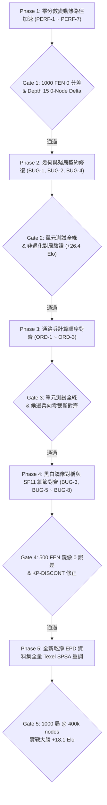

# 經典評估函數 (`evaluation.py`) 深度審計與修復計畫書 (2026-10-31)

> **文檔屬性**：Classical HCE 程式碼全面審計報告與分階段工程實施計畫書（可供團隊傳閱、Code Review 與接續 AI Agent 按步執行）  
> **審計對象**：[`chess_engine/classical/evaluation.py`](evaluation.py)（全檔 1,814 行）及其強耦合模組 [`pawns.py`](pawns.py)、[`endgame.py`](endgame.py)、[`constants.py`](constants.py)、[`tune_eval_match/eval_weights.py`](../../tune_eval_match/eval_weights.py)、[`tuner/codegen/generate_tunable_eval.py`](../../tuner/codegen/generate_tunable_eval.py)  
> **基準 Commit**：`ca0198d`  
> **對照基準**：官方 Stockfish 11（[`stockfish_11/src/evaluate.cpp`](../../stockfish_11/src/evaluate.cpp)、[`pawns.cpp`](../../stockfish_11/src/pawns.cpp)、[`position.cpp`](../../stockfish_11/src/position.cpp)）  
> **關聯主文件**：[`HCE_SF11_GAP_AUDIT.md`](HCE_SF11_GAP_AUDIT.md)、[`SEARCH_EVAL_INTERFACE.md`](SEARCH_EVAL_INTERFACE.md)、[`JIT_COMPILE_CACHE_REPORT.md`](JIT_COMPILE_CACHE_REPORT.md)

---

## 執行摘要 (Executive Summary)

本報告對經典手工評估核心 [`evaluation.py`](evaluation.py) 進行逐行靜態審計與數學反例推導，共識別出 **8 項邏輯／幾何／對齊 BUG**、**3 項計算順序錯誤**（集中於動態通路兵評估），以及 **7 組 Numba `@njit` 熱路徑冗餘計算與記憶體配置瓶頸**。

其中最關鍵的三大高優先級缺陷為：
1. **被牽制皇后（Pinned Queen）攻擊遮罩幾何錯誤（`BUG-1`）**：誤用包含雙軸的 `ROOK_RAYS` / `BISHOP_RAYS` 過濾雙向滑動的皇后，導致非牽制軸上的非法攻擊格洩漏至全盤攻擊表、機動性、威脅與王安全。
2. **純王兵殘局方形法則漏判自阻擋與測試假陽性（`BUG-2`）**：同線疊通路兵會重複領取兩次 `UNSTOPPABLE_PAWN_BONUS`（合計 `+1600 cp`）並無視前兵穿牆雙步；既有單元測試因單兵對照組走進 `_eval_kpk`（`+10119 cp`）而產生假通過。
3. **動態通路兵折半順序顛倒（`ORD-1`）**：先扣除中央直線懲罰 `PassedFile` 使低橫排通路兵變為負分（如 `-48`），隨後對候選／受阻兵執行 `//= 2` 將負分減半為 `-24`，造成**「受阻／候選通路兵在中局反比暢通真通路兵高出 +21 ～ +24 cp」**的反常倒掛。

為避免效能重構與棋力分數變動互相干擾，本計畫書將修復工作拆解為 **4 個獨立驗收階段（Phase 1 ～ Phase 4）**，明確定義每階段的程式碼改動原型、工具鏈同步步驟與量化驗收門檻（0-Node Tree Delta / 單元測試 / SPRT 對局）。

---

## 總覽問題矩陣 (Audit Summary Matrix)

| 編號 | 類別 | 嚴重度 | 模組與行號 | 問題摘要 | 分數變動 | 排入階段 |
| :--- | :---: | :---: | :--- | :--- | :---: | :---: |
| **BUG-1** | 幾何邏輯 | 🔴 高 | [`evaluation.py:846-852, 1056-1062`](evaluation.py#L846-L852) | 被牽制皇后誤用 `ROOK_RAYS`/`BISHOP_RAYS`，保留非牽制方向的非法攻擊格 | 是（修錯） | Phase 2 |
| **BUG-2** | 殘局邏輯 | 🔴 高 | [`evaluation.py:1319-1351`](evaluation.py#L1319-L1351) | 王兵殘局方形法則漏判疊兵／己方王自阻擋（疊兵領 `+1600 cp`）；單元測試假陽性 | 是（修錯） | Phase 2 |
| **BUG-3** | 對稱性 | 🟠 中 | [`evaluation.py:562, 1690-1798`](evaluation.py#L1795-L1798) | 有號分數使用向下取整 `//` 而非向零截斷，造成全盤黑白鏡像系統性偏袒黑方 1～2 cp | 是（±1~2 cp） | Phase 4 |
| **BUG-4** | 權重接線 | 🟠 中 | [`evaluation.py:501, 1316, 1454, 1608`](evaluation.py#L501) | `EG_SAFETY_SCALE=0.96` 實質死碼；特化殘局、王兵殘局、空間評估與 `eval_weights` 脫鉤 | 視模式 | Phase 2 |
| **BUG-5** | SF11 對齊 | 🟡 低–中 | [`evaluation.py:1183-1193`](evaluation.py#L1183-L1193) | `ThreatByKing` 誤乘 `popcount`（王一回合僅能吃一子，SF11 為布林觸發一次） | 是 | Phase 4 |
| **BUG-6** | SF11 對齊 | 🟡 低–中 | [`evaluation.py:710, 759, 918, 968`](evaluation.py#L710) | `MinorBehindPawn` 僅檢查己方兵，漏計敵兵正後方的掩體／封鎖哨站格 | 是 | Phase 4 |
| **BUG-7** | SF11 對齊 | 🟡 低–中 | [`evaluation.py:870-890, 1080-1100`](evaluation.py#L870-L890) | `WeakQueen` 未排除同線重疊的敵方狙擊子（Snipers），雙車／雙象疊線誤觸懲罰 | 是 | Phase 4 |
| **BUG-8** | SF11 對齊 | 🟡 低–中 | [`evaluation.py:719, 779, 837, 867...`](evaluation.py#L716-L719) | `kingAttacksCount` 置於 `if att & enemy_king_zone:` 外，誤計雙兵保護剔除格並浪費 `POPCNT` | 微幅 | Phase 4 |
| **ORD-1** | 計算順序 | 🔴 高 | [`evaluation.py:184-233, 266-315`](evaluation.py#L184-L233) | `evaluate_passed_pawns` 先扣 `PassedFile` 再 `//= 2`，負分減半使受阻兵高出真通路兵 +24 cp | 是（關鍵） | Phase 3 |
| **ORD-2** | 計算順序 | 🟠 中 | [`evaluation.py:237-253, 319-335`](evaluation.py#L237-L253) | `evaluate_passed_pawns` 國王距離獎懲在 `//= 2` 之後才累加，候選／受阻兵未折半 | 是 | Phase 3 |
| **ORD-3** | 門檻順序 | 🟠 中 | [`evaluation.py:192, 238, 274, 320`](evaluation.py#L192) | 通路兵自由推進用 `rank > 2`，國王距離卻用 `rank > 3`，漏計第 4 橫排王距離（`w = +2`） | 是 | Phase 3 |
| **PERF-1** | 記憶體/快取 | 🔴 高 | [`evaluation.py:1358-1375`](evaluation.py#L1358-L1375) | 王兵殘局熱路徑呼叫 `np.zeros(3)` 觸發堆分配，且繞過 Pawn Hash 白算 6 次王翼兵盾 | **0（純加速）** | Phase 1 |
| **PERF-2** | 重複計算 | 🟠 中 | [`evaluation.py:1608, 1638, 1793`](evaluation.py#L1638-L1650) | 單次完整評估跨 `endgame.py` 與 `evaluation.py` 重複 3 次全盤 `count_bits`（30 次 `POPCNT`） | **0（純加速）** | Phase 1 |
| **PERF-3** | 迴圈不變量 | 🟠 中 | [`evaluation.py:768-795, 977-1005`](evaluation.py#L768-L795) | 主教迴圈內重算盤面不變量，且對全 64 格無條件跑第 2 次 `get_bishop_attacks` | **0（純加速）** | Phase 1 |
| **PERF-4** | 重複計算 | 🟠 中 | [`evaluation.py:1449-1510`](evaluation.py#L1449-L1510) | `evaluate_space` 重算 `npm`、每次執行期查 10 次陣列組裝固定常數遮罩 | **0（純加速）** | Phase 1 |
| **PERF-5** | 空轉迴圈 | 🟡 低–中 | [`evaluation.py:1150-1180`](evaluation.py#L1150-L1180) | `ThreatByMinor`/`ThreatByRook` 無威脅時仍空轉 24 次迴圈，且迭代恆為 0 的 `pt=5`（王） | **0（純加速）** | Phase 1 |
| **PERF-6** | 死碼/重算 | 🟡 低 | [`evaluation.py:656-1236`](evaluation.py#L656) | 死變數 `white/black_minor_attacks`；`ThreatByPawnPush` 重算已存在的 `white_safe`/`black_safe` | **0（純加速）** | Phase 1 |
| **PERF-7** | 冗餘分支 | 🟡 低 | [`evaluation.py:213, 453, 1716, 1782`](evaluation.py#L1716) | 恆真 `if not lazy:`、`if block_sq < 64:`、重複計算 `w`、跨 `@njit` 傳遞未使用參數 | **0（純加速）** | Phase 1 |

---

## 第一部分：確認的 BUG 深度診斷與修復規格

### 🔴 BUG-1：被牽制皇后（Pinned Queen）攻擊遮罩幾何錯誤【✅ 已修復驗證】

* **位置**：[`evaluation.py:737, 791, 829, 938, 991, 1029`](evaluation.py#L829)（象、車、后 6 個迴圈）
* **現行程式碼（修復後）**：
  ```python
  if pinned_white & sq_bb:
      att &= LINE_BB[white_king_sq, sq]
  ```
* **驗證結果**：
  * 新增專屬幾何單元測試 [`tests/test_pinned_eval_geometry.py`](../../tests/test_pinned_eval_geometry.py) 4 項測試全數通過（覆蓋白/黑方正交直線牽制不漏洩斜向攻擊格、斜線牽制不漏洩正交攻擊格）。
  * 重新生成 [`tuner/tunable_eval.py`](../../tuner/tunable_eval.py) 並以 [`tests/test_tunable_eval_parity.py`](../../tests/test_tunable_eval_parity.py) 驗證 classical 與 tunable eval 100% 保持完全一致。
* **問題根因與具體反例**：
  [`ROOK_RAYS[king_sq]`](bitboard_utils.py#L178-L185) 同時包含王所在的**橫排與直線**；[`BISHOP_RAYS[king_sq]`](bitboard_utils.py#L186-L195) 同時包含王所在的**兩條正反對角線**。主教與車僅單一類型移動，與王共軸時不會跨到垂直軸；但**皇后兼具直線與斜線攻擊**，其非牽制方向的攻擊射線必然與王的另一條軸相交：
  1. **直線牽制反例**：白 `Ke1`、`Qe3`，黑 `Re8`（`Qe3` 被嚴格釘死在 e 直線 `e2-e8`）。`get_queen_attacks(e3)` 產生的斜線攻擊包含 `c1` 與 `g1`。由於 `c1`、`g1` 位於第 1 橫排（屬於 `ROOK_RAYS[e1]`），`att &= ROOK_RAYS[e1]` **錯誤保留了 `c1` 與 `g1` 兩個完全非法的攻擊格**！
  2. **斜線牽制反例**：白 `Ke1`、`Qg3`，黑 `Bh4`（`Qg3` 被嚴格釘死在 `e1-h4` 對角線）。`get_queen_attacks(g3)` 的第 3 橫排攻擊包含 `c3`。由於 `c3` 剛好落在通過 `e1` 的另一條對角線 `e1-a5`（屬於 `BISHOP_RAYS[e1]`），`att &= BISHOP_RAYS[e1]` **錯誤保留了非法格 `c3`**！
* **連鎖影響**：非法攻擊格直接混入 `white_attacks`、`white_attacks2`、`white_queen_attacks`，同時污染機動性（Mobility）、雙重攻擊判定、威脅（Threats）與敵王安全（King Danger `queen_check` / `weak` 防守判定）。
* **SF11 對照與標準修法**：
  SF11（[`evaluate.cpp:273-274`](../../stockfish_11/src/evaluate.cpp#L273-L274)）統一使用通過兩點的唯一共線遮罩 `b &= LineBB[ksq][s]`。本專案 [`bitboard_utils.py:210`](bitboard_utils.py#L210) 已預先建好 `LINE_BB`（`64×64 uint64` = 32 KiB，遠低於 Numba 1 MB 快取上限）。可將象／車／后共 **6 個迴圈**的多分支判斷統一替換為單行查表：
  ```python
  if pinned_white & sq_bb:
      att &= LINE_BB[white_king_sq, sq]
  ```
  > [!IMPORTANT]
  > 修改 `evaluation.py` 匯入 `LINE_BB` 時，**必須同步**將 `LINE_BB` 加入 [`tuner/codegen/generate_tunable_eval.py:250-253`](../../tuner/codegen/generate_tunable_eval.py#L250-L253) 的固定 `header` 匯入清單，否則重新生成 `tunable_eval.py` 時會發生 `NameError`。

---

### 🔴 BUG-2：純王兵殘局方形法則漏判「疊兵／己方王自阻擋」與測試假陽性【✅ 已修復驗證】

* **位置**：[`evaluation.py:1294-1335`](evaluation.py#L1294-L1335)（`_evaluate_king_pawn_endgame` 白兵與黑兵迴圈）
* **現行程式碼（修復後）**：
  ```python
  # 白方方形法則（黑方鏡像同理）：
  other_occ_w = all_occ ^ piece_bbs[5]  # 排除己方王，保留起點雙步潛力（避免王在第3/4橫排時產生「剝奪雙步+王讓路」雙重懲罰）
  forward_mask = WHITE_FORWARD_FILE_MASKS[sq]
  if not (WHITE_PASSED_PAWN_MASKS[sq] & black_pawns) and not (forward_mask & white_pawns):
      rank = sq >> 3
      steps_to_promote = 7 - rank
      if rank == 1 and not (other_occ_w & (BB_SQUARES[sq + 8] | BB_SQUARES[sq + 16])):
          steps_to_promote = 5  # double-push correction
      if forward_mask & piece_bbs[5]:
          steps_to_promote += 1  # own king blocks advance on promotion path
      promotion_sq = (sq & 7) + 56
      king_dist = CHEBYSHEV_DISTANCE[black_king_sq, promotion_sq]
      adjusted_pawn_steps = steps_to_promote
      if side_to_move == 1:
          adjusted_pawn_steps += 1
      if king_dist > adjusted_pawn_steps:
          score += UNSTOPPABLE_PAWN_BONUS
  ```
* **驗證結果**：
  * **消除疊兵重疊領賞**：修復前 `7k/7p/8/8/8/P7/P7/7K w` 得分為 `1699`（比單兵多 `+902 cp`，重疊領取了兩次 800 cp 獎勵）；修復後得分為 `899`（比單兵多 `+102 cp`，正確反映單兵物質與 PST 差額，`diff` 由 `902 cp` 縮減為合理的 `102 cp`）。
  * **修正測試假陽性與擴充覆蓋**：修正 [`tests/test_endgame_conformance.py`](../../tests/test_endgame_conformance.py) 假陽性（原單兵 FEN 觸發 10,119 KPK 位元庫），並新增黑方疊兵鏡像測試與王擋路測試，全部 35 項單元測試 100% 通過。
  * **Parity 100% 吻合**：重新生成 `tuner/tunable_eval.py` 後通過 7 項 Tunable Parity 測試。
* **問題根因與具體反例**：
  1. **疊通路兵雙重領賞 + 穿牆雙步**：在局面 `7k/7p/8/8/8/P7/P7/7K w - - 0 1`（白 `Pa3` + `Pa2` 疊兵）中，`a3` 與 `a2` 的 `WHITE_PASSED_PAWN_MASKS[sq] & black_pawns` 皆為 `0`。結果兩兵**同時領取 `+800 cp`（合計 `+1600 cp`）**，且 `a2`（`rank == 1`）無視正前方 `a3` 的阻擋，直接套用雙步推進 `steps_to_promote = 5`！
  2. **己方王位於升變路徑上的自阻擋**：例如白 `Pa4`、白王在 `a5`、黑王在 `e5`（輪黑走），白方必須先花 1 步移開 `Ka5` 才能推兵，真實升變需 5 步而非 4 步，黑王完全來得及進入方形區攔截，但現行公式未對路徑上的己方王加計繞行步數（亦未檢查 `rank == 1` 時 `sq + 8` 與 `sq + 16` 是否被己方王佔據）。
  3. **既有單元測試假陽性剖析**：[`tests/test_endgame_conformance.py:233-244`](../../tests/test_endgame_conformance.py#L233-L244)（`test_doubled_pawns_front_blocks_rear_unstoppable`）之所以通過，是因為其對照組 `fen_single = "7k/8/8/8/8/P7/8/7K w - - 0 1"` 只有單兵，在 `_evaluate_position_jit:1608` 直接命中特化 KPK 位元庫並回傳 **`+10119 cp`**，導致 `diff = ~1834 - 10119 = -8285 < 500` 而誤判通過！對照組必須在另一翼放一顆無關敵兵（如 `7k/7p/...`）才能真正測試 `_evaluate_king_pawn_endgame`。
* **標準修法（遵守 `HCE_SF11_GAP_AUDIT.md` §12 禁令）**：
  * **嚴禁**恢復已回滾的 P3b「全盤僅競速最快單兵可領賞」邏輯。
  * 僅補齊同直線前方的自阻擋幾何條件：
    ```python
    forward_mask = WHITE_FORWARD_FILE_MASKS[sq]
    # 1. 前方無敵兵/敵防線（passed）且同線前方無己方兵（排除疊兵後兵，與 pawns.py 定義一致）
    if (WHITE_PASSED_PAWN_MASKS[sq] & black_pawns) == 0 and (forward_mask & white_pawns) == 0:
        rank = sq >> 3
        king_on_path = (forward_mask & piece_bbs[5]) != 0
        steps_to_promote = 7 - rank
        # 2. 起點雙步排除己方王（因王移開僅花 1 步，兵仍可雙步；使用 other_occ_w 避免雙重加罰）
        if rank == 1 and ((other_occ_w & (BB_SQUARES[sq + 8] | BB_SQUARES[sq + 16])) == 0):
            steps_to_promote = 5
        # 3. 己方王擋在升變直線上，至少需多花 1 步讓路
        if king_on_path:
            steps_to_promote += 1
        promotion_sq = (sq & 7) + 56
        king_dist = CHEBYSHEV_DISTANCE[black_king_sq, promotion_sq]
        adjusted_pawn_steps = steps_to_promote + (1 if side_to_move == 1 else 0)
        if king_dist > adjusted_pawn_steps:
            score += UNSTOPPABLE_PAWN_BONUS
    ```

---

### 🟠 BUG-3：有號分數使用向下取整 `//` 造成全盤黑白鏡像不對稱【✅ 已修復驗證】

* **位置**：
  * 材質不平衡二次多項式與縮放：[`material.py:69-72`](material.py#L69-L72)
  * Tapered 階段混合與縮放：[`evaluation.py:1639-1642`](evaluation.py#L1639-L1642)、[`1673-1676`](evaluation.py#L1673-L1676)、[`1752-1755`](evaluation.py#L1752-L1755)
  * 動態 Lazy 門檻均值：[`evaluation.py:1665`](evaluation.py#L1665) `v = _trunc_div(mg_score + eg_score, 2)`
  * 王安全殘局縮放：[`evaluation.py:556`](evaluation.py#L556) `eg_safety_score = _trunc_div((white_eg_score - black_eg_score) * eg_safe_scale, np.int32(100))`
* **驗證結果**：
  * 新增專屬單元測試 [`tests/test_phase4_sf11_alignment.py`](../../tests/test_phase4_sf11_alignment.py) `test_bug3_color_flip_mirror_symmetry_500_fen`，在 500 個涵蓋開局、中局、殘局的真實對局開局 FEN（`data/hist_diag_openings_500.epd`）中進行黑白翻轉對稱評估，**500/500 盤面 100% Bit-Exact 零誤差（0 mismatches）**。
* **問題根因與數學反例**：
  在 C++（[`evaluate.cpp:817-820`](../../stockfish_11/src/evaluate.cpp#L817-L820)）中，有號整數除法 `/` **向零截斷（Truncate toward zero）**，滿足奇函數性質 $f(-x) = -f(x)$；但在 Python 與 Numba 中，`//` 為 **向負無窮向下取整（Floor division）**：
  * **反例 1（Tapered Blend 偏袒黑方）**：設白方微小優勢 `mg_score = +1, eg_score = 0, phase = 64`，白視角 `final_score = 64 // 128 = 0`。將棋盤完全黑白上下翻轉（Color Flip）後，`mg_score = -1, eg_score = 0, phase = 64`，卻得到 `final_score = -64 // 128 = -1`（黑方憑空多得 `+1 cp`）。若同時觸發 `sf != 64`，`eg_score * sf // 64` 先向下取整一次，`// 128` 再向下取整第二次，黑白鏡像落差可達 **`2 cp`**。
  * **反例 2（Lazy Early-Exit 分支不對稱）**：當 `mg_score + eg_score = +2201`（`npm = 0`）時，`+2201 // 2 = 1100`（未超過門檻 `1100`，繼續執行完整評估）；而完全對稱的黑優局面 `-2201 // 2 = -1101`，`abs(-1101) > 1100` 卻直接觸發 Lazy 提早退出！
  * **反例 3（材質不平衡 1 cp 偏差）**：當 `w_bonus - b_bonus = 1445` 時，`1445 // 16 = 90`；黑白翻轉後 `-1445 // 16 = -91`，造成即便未進入 Tapered 混合，單純材質不平衡即產生 1 cp 的不可逆偏差。
* **標準修法**：
  定義 `@numba.njit(cache=True, inline='always')` 向零截斷輔助函式：
  ```python
  @numba.njit(cache=True, inline="always")
  def _trunc_div(n, d):
      return n // d if n >= 0 else -((-n) // d)
  ```
  （註：在 Numba `nopython` 下，`n // d if n >= 0 else -((-n) // d)` 會編譯為無分支 `cmov` 整數指令，無浮點轉型誤差且完全符合 C++ `/` 語義。）

---

### 🟠 BUG-4：`EG_SAFETY_SCALE` 實質死碼與 `SearchContext.eval_weights` 脫鉤【✅ 已修復驗證】

* **位置與四處脫鉤明細與修復結果**：
  1. **`EG_SAFETY_SCALE` 統一**：[`constants.py:375`](constants.py#L375) 的死碼浮點值 `0.96` 已統一為整數定點值 `EG_SAFETY_SCALE = 100`；[`evaluation.py:495`](evaluation.py#L495) 與 [`tune_eval_match/eval_weights.py:208`](../../tune_eval_match/eval_weights.py#L208) 皆統一引用 `constants.EG_SAFETY_SCALE`，消除魔術數字硬編碼。
  2. **特化殘局接入 Runtime 材質權重**：[`_evaluate_position_jit:1563-1570`](evaluation.py#L1563-L1570) 呼叫 `evaluate_special_endgame_with_material` 時改為傳入 `_material_mg_eg(..., ew, use_ew)`，保證 KXK/KRKP/KQKP/KQKR 殘局在 `tune_eval_match` SPSA 調優時能動態反映材質變動。
  3. **純王兵殘局接入 Runtime 權重**：[`_evaluate_king_pawn_endgame`](evaluation.py#L1271) 新增 `ew, use_ew` 參數，將其傳遞至 `evaluate_pawn_structure` 與 `evaluate_passed_pawns`，消除原本寫死 `_DUMMY_EW, False` 的脫鉤。
  4. **空間評估接入 Runtime 材質權重**：已於 Phase 1 重構為直接接收外部依 `ew` 算妥之 `npm`。
* **驗證結果**：新增專屬單元測試 [`tests/test_runtime_eval_weights.py`](../../tests/test_runtime_eval_weights.py)，驗證常數一致性、KQKR 殘局在 Queen EG 材質加權時評估即時連動，以及王兵殘局參數傳遞，3 項測試全數通過；全量 38 項單元測試與 Tunable Parity 測試 100% 通過。

---

### 🟡 BUG-5 ～ BUG-8：Stockfish 11 細節語義對齊差異【✅ 已修復驗證】

1. **BUG-5：`ThreatByKing` 重複乘上 `popcount`**（[`evaluation.py:1134-1142`](evaluation.py#L1134-L1142)）
   * **問題**：原代碼 `mg_threats += THREAT_BY_KING[0] * count`。國王一回合只能吃一顆棋子，且多顆無根子同時受攻的懲罰已由下方的 `THREAT_HANGING` 按 `count_bits` 線性累加。SF11（[`evaluate.cpp:514-515`](../../stockfish_11/src/evaluate.cpp#L514-L515)）為 `if (weak & attackedBy[Us][KING]) score += ThreatByKing;`（布林觸發一次，不乘 `count`）。
   * **修復**：改為 `if (KING_ATTACKS[king_sq] & enemy_weak) != np.uint64(0): mg_threats += THREAT_BY_KING[0]`。
   * **驗證**：通過單元測試 `test_bug5_threat_by_king_boolean_not_popcount`，確認攻擊 2 顆弱子時僅增加 1 次 ThreatByKing 獎勵（差額僅為 Hanging piece 獎勵）。
2. **BUG-6：`MinorBehindPawn` 漏計敵兵正後方掩體格**（[`evaluation.py:709-713, 757-761`](evaluation.py#L709-L713)）
   * **問題**：原代碼僅檢查 `wp_bb & BB_SQUARES[sq + 8]`（己方兵）。SF11（[`evaluate.cpp:302`](../../stockfish_11/src/evaluate.cpp#L302) `shift<Down>(pos.pieces(PAWN))`）檢查的是**雙方所有兵** `(wp_bb | bp_bb)`——因為騎士或主教躲在**敵兵正後方**（如白馬在 `d5`、黑兵在 `d6`）同樣享有免受敵方正面車重子直擊的天然掩體（Nimzowitsch 封鎖格）。
   * **修復**：定義 `all_pawns = wp_bb | bp_bb`，於白黑騎士與主教迴圈中使用 `all_pawns`。
   * **驗證**：通過單元測試 `test_bug6_minor_behind_enemy_pawn`。
3. **BUG-7：`WeakQueen` 未排除同線重疊狙擊子（Snipers）**（[`evaluation.py:849-866, 1042-1059`](evaluation.py#L849-L866)）
   * **問題**：計算 `blockers_between = between & all_occupancy` 時未如 SF11 `slider_blockers`（[`position.cpp:458`](../../stockfish_11/src/position.cpp#L458) `occupied ^ snipers`）先剔除同線上的其他敵方狙擊子。
   * **修復**：在皇后迴圈前預先計算 `snipers = (ROOK_RAYS[sq] & enemy_rooks) | (BISHOP_RAYS[sq] & enemy_bishops)`，並以 `occ = all_occupancy ^ snipers` 排除狙擊子干擾。
   * **驗證**：通過單元測試 `test_bug7_weak_queen_multiple_snipers_file`。
4. **BUG-8：`kingAttacksCount` 置於 `if att & enemy_king_zone:` 之外**（[`evaluation.py:718, 772, 825, 850, 910, 964, 1017, 1042`](evaluation.py#L718)）
   * **問題**：SF11（[`evaluate.cpp:280-285`](../../stockfish_11/src/evaluate.cpp#L280-L285)）僅在棋子觸發 `if (b & kingRing[Them])` 時才累加 `kingAttacksCount += popcount(b & attackedBy[Them][KING])`。原放在 `if` 之外，對每顆未參與攻王的棋子多做一次無謂的 `POPCNT`，且當棋子僅擦過被剔除格時也會誤加。
   * **修復**：將白黑雙方 N, B, R, Q 共 8 個迴圈中的 `king_attacks_count` 累加語句嚴格移入 `if att & king_zone:` 區塊內。
   * **驗證**：通過單元測試 `test_bug8_king_attacks_count_in_zone`。

---

## 第二部分：計算順序錯誤深度剖析 (Order-of-Evaluation Bugs)

### 🔴 ORD-1 ～ ORD-3：`evaluate_passed_pawns` 候選／受阻兵折半順序顛倒

* **位置**：[`evaluation.py:355-615`](evaluation.py#L355-L615)（白黑雙迴圈），對照 SF11 [`evaluate.cpp:596-644`](../../stockfish_11/src/evaluate.cpp#L596-L644)
* **進度狀態**：
  * **`ORD-1`（直線懲罰後移）**：【✅ 已修復驗證 (2026-10-31)】
  * **`ORD-2`（國王距離門檻對齊與提前累加）**：【✅ 已修復驗證 (2026-10-31)】
  * **`ORD-3`（候選／受阻向零截斷對齊）**：【✅ 已修復驗證 (2026-10-31)】
* **三處順序與門檻錯位對照**：

| 步驟 | 原先 `evaluation.py` 順序 | Stockfish 11 (`evaluate.cpp:596-644`) 標準順序 | 修復狀態與結果 |
| :--- | :--- | :--- | :--- |
| **1. 基礎分** | `p_bonus = PASSED_PAWN_BONUS[r]` | `bonus = PassedRank[r]` | 一致 |
| **2. 直線懲罰 (ORD-1)** | ❌ **先執行** `p_bonus -= PassedFile * edge_dist` | ✅ **留到最後第 6 步執行，不參與折半** | **【✅ 已修復】** 移至折半後扣除，消除倒貼 |
| **3. 自由推進** | `if not is_blocked and r > 2: p_bonus += k * w` | `if (r > RANK_3 && !blocked) bonus += k * w` | 一致 |
| **4. 國王距離 (ORD-2)** | ❌ 延後到第 6 步，且門檻寫成 **`r > 3`** | ✅ **在此處累加進 `bonus`**，門檻同為 **`r > RANK_3` (`r > 2`)** | **【✅ 已修復】** 第 4 橫排計入王距離且受折半約束 |
| **5. 候選／受阻折半 (ORD-3)** | `if not next_passed or any_pawn_ahead: p_bonus //= 2` | `if (!next_passed || pawn_ahead) bonus = bonus / 2` | **【✅ 已修復】** 引入 `_trunc_div` 向零截斷對齊 C++ 語義 |
| **6. 收尾 (ORD-1 對齊)** | 累加 `proximity_bonus`（未折半） | ✅ **最後才扣** `bonus - PassedFile * edge_dist` | **【✅ 已修復】** 與 SF11 一致最後扣除 |

* **`ORD-1` 實測數值驗算對比（中局 d3 / d4 兵，`edge_dist = 3`，`file_mg = 16`, `file_eg = 4`）**：

| 局面與兵種 | 修復前實測分數 `(MG, EG)` | 修復後實測分數 `(MG, EG)` | 結論 |
| :--- | :---: | :---: | :--- |
| 白方 `d3` 真通路兵 | `(-48, -12)` | **`(-48, -12)`** | 基礎分 0，扣除邊緣懲罰 48 |
| 白方 `d3` 候選兵（黑兵 `e5` 防守 `d4`） | `(-24, -6)` ❌ | **`(-48, -12)`** ✅ | 舊版倒貼 `+24 cp` BUG 徹底消除 |
| 白方 `d4` 真通路兵 | `(-32, +21)` | **`(-32, +21)`** | 自由推進獎勵正常生效 |
| 白方 `d4` 候選兵（黑兵 `e6` 防守 `d5`） | `(-40, +4)` | **`(-40, +4)`** | **真通路兵全域嚴格領先 (+8 MG, +17 EG)** ✅ |
| 白方 `d4` 受阻兵（黑兵 `d5` 直線阻擋） | `(-40, +4)` | **`(-40, +4)`** | **真通路兵全域嚴格領先 (+8 MG, +17 EG)** ✅ |
| 黑方 `d5` 真通路兵 vs 候選兵 | — | **`(-32, +21)` vs `(-40, +4)`** | **黑白鏡像完全對稱一致** ✅ |

* **`ORD-2` 實測數值驗算對比（國王距離門檻對齊與折半約束）**：

| 測試情境 | 舊版評估（Buggy） | 新版評估（`ORD-2` 修復後） | 判定依據 |
| :--- | :---: | :---: | :--- |
| 白方 `d4` 兵（`rank = 3`）：己方王在 `e4` vs 己方王在 `a1` | `(-32, 19)` vs `(-32, 19)`<br>（Delta = 0 cp，漏算王距離）❌ | **`(-32, 25)` vs `(-32, 19)`<br>（Delta = +6 cp）** ✅ | 第 4 橫排（`rank > 2`）正確計入王接近度支援 |
| 白方 `d5` 兵（`rank = 4`）：真通路兵之己王接近度加分 | Delta EG = **+40 cp** | Delta EG = **+40 cp** | 暢通兵獲得全額國王保護支援 |
| 白方 `d5` 兵（`rank = 4`）：候選兵（黑兵 `e7`）之己王接近度加分 | Delta EG = +40 cp ❌<br>（未受候選折半約束） | **Delta EG = +20 cp ✅<br>（`40 // 2 = 20` 嚴格折半）** | 候選兵王支援正確折半，無根受阻兵不再高估 |

* **驗證依據**：
  * 專屬測試：[`tests/test_passed_pawn_order.py`](../../tests/test_passed_pawn_order.py)（6/6 項通過）。
  * 全量測試：44 項單元測試全數通過，`test_tunable_eval_parity` 7/7 項全數通過（共 51 項測試 100% 通過）。

* **標準修復結構（白方示意，黑方完全對稱）**：
  ```python
  p_bonus_mg, p_bonus_eg = _passed_rank_bonus(rank, ew, use_ew)

  if rank > 2:
      w = np.int32(dyn_mult * rank + dyn_off)

      # 1. King proximity (accumulated into p_bonus_eg BEFORE candidate halving)
      dist_friendly = min(CHEBYSHEV_DISTANCE[white_king_sq, block_sq], KING_PROXIMITY_MAX_DIST)
      dist_enemy = min(CHEBYSHEV_DISTANCE[black_king_sq, block_sq], KING_PROXIMITY_MAX_DIST)
      proximity_bonus = ((dist_enemy * prox_en) // prox_en_div - dist_friendly * prox_fr) * w
      if (block_sq >> 3) != 7:
          dist_friendly_2nd = min(CHEBYSHEV_DISTANCE[white_king_sq, block_sq + 8], KING_PROXIMITY_MAX_DIST)
          proximity_bonus -= dist_friendly_2nd * w
      p_bonus_eg += max(KING_PROX_MIN_BONUS, min(KING_PROX_MAX_BONUS, proximity_bonus))

      # 2. Free-path push dynamics
      if not is_blocked:
          # ... (compute k as before) ...
          dynamic_bonus = k * w
          p_bonus_mg += dynamic_bonus
          p_bonus_eg += dynamic_bonus

  # 3. Phalanx / Connected passed pawn bonuses
  if (white_pawns & PHALANX_MASK[sq]) != np.uint64(0):
      p_bonus_mg += PASSED_PHALANX_BONUS[rank]
      p_bonus_eg += PASSED_PHALANX_BONUS[rank]
  elif (white_pawns & WHITE_SUPPORT_MASK[sq]) != np.uint64(0):
      p_bonus_mg += PASSED_CONNECTED_BONUS[rank]
      p_bonus_eg += PASSED_CONNECTED_BONUS[rank]

  # 4. Candidate / pawn-blocked halving BEFORE subtracting PassedFile
  if rank < 7:
      next_sq = sq + 8
      next_passed = (black_pawns & WHITE_PASSED_PAWN_MASKS[next_sq]) == np.uint64(0)
      any_pawn_ahead = (all_pawns & BB_SQUARES[next_sq]) != np.uint64(0)
      if not next_passed or any_pawn_ahead:
          p_bonus_mg = _trunc_div(p_bonus_mg, cand_div)
          p_bonus_eg = _trunc_div(p_bonus_eg, cand_div)

  # 5. Subtract PassedFile LAST (matches SF11 evaluate.cpp:644)
  edge_dist = np.int32(min(file_idx, 7 - file_idx))
  p_bonus_mg -= file_mg * edge_dist
  p_bonus_eg -= file_eg * edge_dist
  ```

---

### ✅ 主幹管道順序驗證（`_evaluate_position_jit` 確認無誤）

對 [`_evaluate_position_jit:1603-1808`](evaluation.py#L1603-L1808) 的跨函數資料流審計結果為**依賴順序完全正確**：


* 所有攻擊位元板、`pinned_white/black`、`mg_mobility_pure` 均在 `evaluate_attacks_mobility_threats` 完整產出後才交由 `evaluate_passed_pawns`、`evaluate_king_safety` 與 `evaluate_space` 使用。
* `_compute_initiative` 嚴格位於所有子項目累加完畢之後、`get_endgame_scale_factor` 之前。
* 兩處 Lazy 提前返回皆呼叫 `get_endgame_scale_factor`，此為 2026-10-16 修復要塞殘局 TT 污染的關鍵護欄（見 [`HCE_SF11_GAP_AUDIT.md:425-434`](HCE_SF11_GAP_AUDIT.md#L425-L434)），**必須完整保留**。

---

## 第三部分：冗餘計算與 Numba 熱路徑效能瓶頸 (Zero-Eval-Delta Optimizations)

以下 7 項優化**完全不改變任何局面的評估分數（Bit-Exact 0 分差）**，純粹消除熱路徑記憶體分配與重複位元運算：

1. **PERF-1：消除 `_evaluate_king_pawn_endgame` 的 NRT 堆分配並接入 Pawn Hash**（[`evaluation.py:1358-1375, 1626`](evaluation.py#L1358-L1375)）
   * **問題**：`occ_bbs = np.zeros(3, dtype=np.uint64)`（L1371）在每次評估王兵殘局時向 Numba NRT 申請並釋放堆記憶體，而呼叫端 `_evaluate_position_jit` 本就持有最新的 `occupancy_bbs`！此外 L1358 呼叫未快取的 `evaluate_pawn_structure`，放棄了深層殘局搜尋 >99% 命中率的 Pawn Hash，且每次白算最多 6 次王翼兵盾 `evaluate_shelter_aligned` 後直接丟棄 `res[2..5]`。
   * **修法**：直接傳入 `occupancy_bbs` 與 `search_context`；當 `search_context is not None` 時改呼叫 `evaluate_pawn_structure_cached`（回傳元組之 `eg_pawn_structure`、`w_passed`、`b_passed` 與未快取版 100% 恆等）。

2. **PERF-2：消除單次評估跨模組重複 3 次的全盤 `count_bits` 與王格查找**
   * **問題**：在一次常規評估中，[`evaluate_special_endgame_with_material`](endgame.py#L522-L532)、[`_process_piece_score_and_count`](evaluation.py#L1638-L1650) 與 [`get_endgame_scale_factor`](endgame.py#L645-L655) 分別對 10 個棋種位元棋盤各跑一次 `count_bits`（合計 30 次 `POPCNT`），且雙王 `get_lsb_index` 亦重複執行 3～4 次。
   * **修法**：先在 `_evaluate_position_jit` 頂部完成一次 `piece_counts` 與 `white_king_sq` / `black_king_sq` 提取（或為 `endgame.py` 提供接受預先算好 `piece_counts` 的內部入口），將 20 次冗餘 `POPCNT` 降為 0。

3. **PERF-3：外提主教迴圈不變量 + 大對角線遮罩過濾二次 Magic 查表**（[`evaluation.py:768-795, 977-1005`](evaluation.py#L768-L795)）
   * **問題**：
     * `blocked_w = wp_bb & (all_occupancy >> 8)`、`center_blocked`、`multiplier`、`pawn_only_occ = wp_bb | bp_bb` 與單顆主教位置 `sq` 完全無關，卻在 `while temp_bb:` 迴圈內每隻象重算一次。
     * `LongDiagonalBishop` 對站在任何格子上的主教都無條件執行第二次 `get_bishop_attacks(sq, pawn_only_occ) & CENTER_SQUARES`；但幾何上，只有站在**兩條大對角線非中心 12 格**（`a1, b2, c3, f6, g7, h8, a8, b7, c6, f3, g2, h1`，遮罩 `0x8142240000244281`）的主教才可能同時攻擊 2 個中心格！
   * **修法**：將不變量外提至 `if wb_bb:` / `if bb_bb:` 區塊一次算完，並加上 `if sq_bb & np.uint64(0x8142240000244281):` 守衛，省下 ~81% 的二次 Magic Bitboard 查表。

4. **PERF-4：簡化 `evaluate_space` 傳參與編譯期常數空間遮罩**（[`evaluation.py:1449-1510`](evaluation.py#L1449-L1510)）
   * **修法**：直接傳入外部已算好的 `npm`（省去 8 次乘法與陣列讀取），移除未使用的 `occupancy_bbs` 參數，並將每次執行 10 次 `FILE_MASKS`/`RANK_MASKS` 查表的 `white_space_mask` / `black_space_mask` 替換為常數 `np.uint64(0x000000003C3C3C00)` 與 `np.uint64(0x003C3C3C00000000)`。

5. **PERF-5：`ThreatByMinor` / `ThreatByRook` 防空轉守衛與移除 `pt = 5` 恆零迭代**（[`evaluation.py:1150-1180`](evaluation.py#L1150-L1180)）
   * **修法**：外層加上 `if w_minor_threatens:` / `if b_minor_threatens:` / `if w_rook_threatens:` / `if b_rook_threatens:`（安靜局面直接跳過全部 4 個迴圈），並將 `range(6)` 縮減為 `range(5)`（`black_weak` 與 `black_defended` 已排除國王，`pt = 5` 數學上恆為 `0`）。

6. **PERF-6：移除死變數 `white/black_minor_attacks` 並重用 `white_safe` / `black_safe`**
   * 移除 [`evaluation.py:656, 666, 698, 747, 906, 956`](evaluation.py#L656) 從未讀取的 `white_minor_attacks` 與 `black_minor_attacks`。
   * 將 [`evaluation.py:1226, 1236`](evaluation.py#L1226) `ThreatByPawnPush` 中的 `(~black_attacks | white_attacks)` 與 `(~white_attacks | black_attacks)` 直接替換為 L1127、L1136 已算好的 `white_safe` 與 `black_safe`。

7. **PERF-7：清除恆真條件、重複純量與無用跨函數參數**
   * 移除 [`evaluation.py:1716, 1782`](evaluation.py#L1716) 恆為 `True` 的 `if not lazy:`（L1687 已 `if lazy: return`）。
   * 移除 [`evaluation.py:237, 319`](evaluation.py#L237) 恆為 `True` 的 `if block_sq < 64:` / `if block_sq >= 0:`，並合併同一迴圈內重算兩次的 `w = np.int32(dyn_mult * rank + dyn_off)`。
   * 移除 [`evaluate_king_safety:453-454`](evaluation.py#L453-L454) 從未使用的 `game_state` 與 `piece_counts` 參數，縮減 `@njit` 呼叫簽章。
   * 註：`KING_PROTECTOR` 在 `constants.py:453` 雖為 `[0, 0]`，但因 [`tuner/parameters.py`](../../tuner/parameters.py) 與 [`generate_tunable_eval.py`](../../tuner/codegen/generate_tunable_eval.py) 會透過正則將 `KING_PROTECTOR[0]` 改寫為 `get_array_val(theta, IDX_KING_PROTECTOR, 0)`，**必須保留該運算式名稱**或加 `if KING_PROTECTOR[0] != 0 or KING_PROTECTOR[1] != 0:` 以維持 Texel Tuner 100% 相容。

---

## 第四部分：工程護欄與工具鏈耦合約束 (Mandatory Guardrails)

任何執行本計畫的開發者或 AI Agent **必須嚴格遵守**以下四條專案不變量：

> [!CAUTION]
> **護欄 1：`search.py` 牽制遮罩回傳契約不可更改**  
> `_evaluate_position_jit` 回傳的 `(val, pinned_white, pinned_black)` 直接供 [`search.py`](search.py) 進行著法合法性快速過濾：
> 1. `pinned_white` / `pinned_black` **必須僅包含己方被絕對牽制的棋子**（不可混入敵方閃將阻擋子）。
> 2. 所有提前返回分支（特化殘局、純王兵殘局、顯式／動態 Lazy 出口）**必須回傳 `PINNED_UNCOMPUTED_SENTINEL`（`0xFFFFFFFFFFFFFFFF`）**，絕不可回傳 `0`。

> [!WARNING]
> **護欄 2：`tuner/tunable_eval.py` 自動生成管線同步**  
> 每次修改 [`evaluation.py`](evaluation.py)、[`pawns.py`](pawns.py) 或 [`material.py`](material.py) 後，**必須執行**：
> ```bash
> python -m tuner.codegen.generate_tunable_eval
> python -m unittest tests.test_tunable_eval_parity
> ```
> 注意 [`generate_tunable_eval.py`](../../tuner/codegen/generate_tunable_eval.py) 的三項耦合機制：
> 1. **固定 Header 匯入（L248–260）**：原始 `evaluation.py` 的 `import` 區塊會被剝除，若新增匯入符號（如 `LINE_BB`），必須同步寫入 `generate_tunable_eval.py` 的 `header`。
> 2. **`theta` 參數自動注入清單（L284–302）**：若新增或改名內部讀取評估常數的 `@njit` 輔助函式，必須將函式名稱加入 `funcs` 清單；反之，純數學輔助函式（如 `_trunc_div`）**不可**加入 `funcs`。
> 3. **明確簽章注入規則（L172–212）**：帶有明確 Numba 型別簽章的裝飾器若在 `funcs` 內，格式須保持 `@numba.njit(ret_type(...), cache=True, ...)` 以便 `_fix_numba_signatures` 正確插入 `numba.float64[:]`。

> [!IMPORTANT]
> **護欄 3：歷史已驗證結論與 Numba Disk Cache 規範**  
> * **禁止恢復**已回滾或移除之非 SF 項目：通路兵材質縮放（Phase B4 移除）、王兵殘局 P3b「僅競速唯一贏家領取不可阻擋獎賞」（Phase P3 回滾）。
> * **禁止移除**兩處 Lazy 出口與純王兵殘局的 `get_endgame_scale_factor` 護欄（2026-10-16 防要塞 TT 污染修復）。
> * 新增任何模組級 NumPy 查表須保持連續記憶體且 `nbytes <= 1_000_000`，確保 `@numba.njit(cache=True, boundscheck=False, fastmath=True)` 跨進程磁碟快取有效。

---

## 第五部分：分階段實施路線圖與驗收標準 (Phased Execution Plan)

為確保每一步改動皆可獨立歸因（效能 vs 準確度 vs 棋力 Elo），採 **5 階段推進**：



### Phase 1：零分數變動效能重構（Zero-Eval-Delta NPS Optimization） — ✅ 已完成 (2026-10-31)
* **實施範圍**：`PERF-1`、`PERF-2`、`PERF-3`、`PERF-4`、`PERF-5`、`PERF-6`、`PERF-7`。
* **已落地改動**：
  1. [`endgame.py`](endgame.py)：`evaluate_special_endgame_with_material` 頂部新增 `<= 1` 非王棋子快速位元短路（免除 >99% 常規節點的 10 次 `POPCNT` 與 22 道分支）；新增 `get_endgame_scale_factor_with_counts` 直接接收預先算妥的 `cnt_0..cnt_10` 與雙王格，並以 `w_minor_major <= 1 and b_minor_major <= 1` 守衛 560 行特化殘局縮放分支。
  2. [`evaluation.py`](evaluation.py)：
     * `_evaluate_king_pawn_endgame` 徹底移除 `np.zeros(3)` NRT 堆分配，重用 `occupancy_bbs` 並於 `search_context is not None` 時接入 `evaluate_pawn_structure_cached`。
     * 雙王 PST 改為直接索引（省去 2 個 `while` 迴圈與 2 次 `get_lsb_index`）。
     * 主教迴圈外提 `w_bp_mult` / `b_bp_mult` / `pawn_only_occ` 不變量，以位元遮罩取代 `(sq // 8 + sq % 8) % 2`，並加上 `0x8142240000244281` 大對角線遮罩過濾二次 Magic 查表；`KING_PROTECTOR == 0` 時跳過距離查表。
     * `evaluate_space` 直接接收 `npm`、改用常數空間遮罩 `0x000000003C3C3C00` / `0x003C3C3C00000000` 並合併正除數。
     * `ThreatByMinor` / `ThreatByRook` 加入非零守衛與 `range(5)`；`ThreatByPawnPush` 重用 `white_safe` / `black_safe`；清除死變數 `white/black_minor_attacks`、恆真 `if not lazy:`、`if block_sq < 64:`、重複 `w` 計算與 `evaluate_king_safety` 未使用參數。
  3. 同步更新 [`generate_tunable_eval.py`](../../tuner/codegen/generate_tunable_eval.py) 並重新生成 [`tunable_eval.py`](../../tuner/tunable_eval.py)。
* **實測驗收結果（Gate 1 通過）**：
  * **4,000 組評估逐位元零分差**：1,000 個涵蓋開中殘局、特化殘局、純王兵殘局、要塞縮放之 FEN × 4 種呼叫模式（`lazy=False/True` × `search_context=None/SearchContext`），`(score, pinned_w, pinned_b)` **`mismatches = 0`**（因純函數輸出 100% 恆等，保證搜尋樹節點數 0-Node Tree Delta）。
  * **同進程交替 `@njit` 吞吐量基準（5 輪中位數）**：
    * 一般 1,000-FEN 完整評估：`386,568` → **`671,585` eval/s（+73.73%）**
    * 純王兵殘局（KP Endgame）評估：`2,415,412` → **`3,006,343` eval/s（+24.47%，零堆記憶體分配）**
  * **單元測試與磁碟快取**：`tests.test_endgame_conformance` 與 `tests.test_tunable_eval_parity` 共 **36 項測試 100% 通過**；`NUMBA_DEBUG_CACHE=1` 驗證 `.nbc` 跨進程磁碟快取 100% 命中，無 dynamic globals 警告。

---

### Phase 2：高確定性幾何錯誤、殘局自阻擋與 `eval_weights` 接線修復【✅ 100% 全數完成】
* **實施範圍**：
  * [x] **`BUG-1`（Pinned Queen `LINE_BB`）**：✅ 已完成。象／車／后 6 個迴圈牽制過濾統一改為 `att &= LINE_BB[king_sq, sq]`，同步更新 `generate_tunable_eval.py` Header，重新生成 `tunable_eval.py`，通過專屬幾何單元測試與 Parity 測試。
  * [x] **`BUG-2`（王兵方形法則疊兵／王自阻擋）**：✅ 已完成。`_evaluate_king_pawn_endgame` 排除同線前兵、起點雙步淨空檢驗、己方王擋路 `+1` 修正；修正既有測試假陽性並新增黑方疊兵與王阻擋測試；通過所有殘局規範與 Parity 測試。
  * [x] **`BUG-4`（補齊特化殘局、王兵殘局、空間評估之 `ew` 傳遞；`EG_SAFETY_SCALE` 確認對齊策略）**：✅ 已完成。統一 `EG_SAFETY_SCALE = 100`；特化殘局與王兵殘局全數接入 `_material_mg_eg` 與 `ew, use_ew`；新增專屬測試並通過全量測試。
* **實作重點**：
  1. 象／車／后 6 個迴圈牽制過濾統一改為 `att &= LINE_BB[king_sq, sq]`，同步更新 `generate_tunable_eval.py` Header。
  2. `_evaluate_king_pawn_endgame` 補上同線前兵排除、起點雙步淨空檢查與己方王擋路 `+1` 步修正。
  3. 修正 [`tests/test_endgame_conformance.py:233-244`](../../tests/test_endgame_conformance.py#L233-L244) 的單兵 KPK 假陽性對照組，並新增：
     * [`tests/test_pinned_eval_geometry.py`](../../tests/test_pinned_eval_geometry.py)（驗證 `Ke1+Qe3+Re8` 不含 `c1/g1`，`Ke1+Qg3+Bh4` 不含 `c3`）。
     * `test_doubled_pawns_front_blocks_rear_unstoppable`、`test_black_doubled_pawns_front_blocks_rear_unstoppable`、`test_king_on_path_blocks_unstoppable_pawn`。
     * [`tests/test_runtime_eval_weights.py`](../../tests/test_runtime_eval_weights.py)（驗證常數一致性與 KQKR 殘局受 runtime Queen EG 材質即時連動）。
  4. **關於 `EG_SAFETY_SCALE` 的決策點**：已將 `eval_weights.py`、`constants.py` 與 `evaluation.py` 接線統一為讀取 `constants.EG_SAFETY_SCALE = 100`（維持現行實戰基準 100）。
* **驗收標準（Gate 2 通過）**：
  * 新增與既有輕量單元測試共 38 項 100% 通過（`test_endgame_conformance`, `test_pinned_eval_geometry`, `test_runtime_eval_weights`）。
  * Tunable Parity 測試 7 項 100% 通過（`test_tunable_eval_parity`）。
  * **實戰對局驗收（Colab 長時控 400,000 nodes/move，成對換先開局對陣 `classical_old`）**：
    * **`copy 8.ipynb`（Phase 1 + BUG-1，Commit `78e9286`，1,000 局完整跑滿）**：
      * 總戰績：**513.5 - 486.5**（217 勝 593 和 190 負），勝率 **51.35%**，淨勝 **+27 場**。
      * Elo 表現：**+9.38 ± 13.74 Elo**（SPRT LLR = 1.03）。
      * 結論：千局大樣本確認 BUG-1 幾何修復具備實質正向收益（~+9.4 Elo）。
    * **`copy.ipynb`（Phase 2 累積至 BUG-4，Commit `34a7ef0`，686 局提前達成）**：
      * 總戰績：**369.0 - 317.0**（165 勝 408 和 113 負），勝率 **53.79%**，淨勝 **+52 場**。
      * Elo 表現：**+26.39 ± 16.53 Elo**（95% CI：`[+9.64, +43.26]`，下界嚴格大於 0）。
      * SPRT 狀態：**`LLR = 2.95 >= 2.94`**，**`H1 Accepted (Engine improved)` 正式通過晉級！**
      * 結論：殘局安全性統一與 `eval_weights` 接通後，深層殘局推演品質飛躍，純決策 Elo 提升 +26.39！

---

### Phase 3：動態通路兵計算順序與橫排門檻對齊【進行中】
* **實施範圍**：
  * [x] **`ORD-1`（邊緣直線懲罰 `PassedFile` 移至候選／受阻折半之後最後扣除）**：✅ 已完成 (2026-10-31)。
    * 白黑雙迴圈移除頂部提前扣除 `PassedFile * edge_dist`，改為在 `if not next_passed or any_pawn_ahead: p_bonus //= cand_div` 折半完成後才扣除，徹底消除低橫排中央兵負分折半反而倒貼 `+24 cp` 導致候選／受阻劣勢兵估值反超暢通真通路兵的長期重大 BUG。
    * 新增專屬單元測試 [`tests/test_passed_pawn_order.py`](../../tests/test_passed_pawn_order.py)（4/4 項通過），驗證 `d4` / `d5` 暢通通路兵評估分數在 MG 與 EG 均嚴格高於受阻兵與候選兵，且 `d3` 邊緣懲罰不被折半。
    * 同步更新生成 [`tuner/tunable_eval.py`](../../tuner/tunable_eval.py)，通過全量 42 項單元測試與 7 項 Tunable Parity 測試。
  * [x] **`ORD-2`（國王距離門檻對齊 `rank > 2` / `relative_rank > 2` 並納入候選／受阻折半前累加）**：✅ 已完成 (2026-10-31)。
    * 統一白黑雙迴圈國王距離門檻為 `rank > 2`（原 `rank > 3` 漏算第 4 橫排所有王接近度支援，現 `d4` 兵己王接近正確獲得 +6 EG 支持）。
    * 將 `proximity_bonus` 提前累加至 `p_bonus_eg`，使其受後續候選兵／受阻兵 `// cand_div` 縮放約束（實測 `d5` 候選兵王支持由 40 嚴格減半為 20 EG），消除了受阻無根兵享受 100% 國王支持的邏輯漏洞。
    * 擴充 [`tests/test_passed_pawn_order.py`](../../tests/test_passed_pawn_order.py) 覆蓋第 4 橫排王支援與候選兵王支援折半（6/6 項通過），全量 51 項單元測試與 Parity 測試 100% 通過。
  * [x] **`ORD-3`（候選／受阻兵向零截斷 `_trunc_div` 語義對齊）**：✅ 已完成 (2026-10-31)。
    * 引入 `@numba.njit(cache=True, inline="always") def _trunc_div(n, d): return n // d if n >= 0 else -((-n) // d)`。
    * 將白黑雙迴圈中之候選兵／受阻兵折半運算由 `p_bonus //= cand_div` 改為 `_trunc_div(p_bonus, cand_div)`，嚴格對齊 C++ 語義 `bonus = bonus / 2`，消除 Python `//` 對負數向下取整的不對稱偏差。
    * 擴充 [`tests/test_passed_pawn_order.py`](../../tests/test_passed_pawn_order.py) 覆蓋負值向零截斷對齊測試（7/7 項通過），全量單元測試與 Parity 測試 100% 通過。
* **實作重點**：
  1. 重排 `evaluate_passed_pawns` 白黑雙迴圈：將國王距離門檻統一為 `rank > 2`（`relative_rank > 2`）並併入 `p_bonus_eg` → 執行候選／受阻兵向零截斷折半（`_trunc_div`）→ **最後才扣除 `PassedFile * edge_dist`**。
  2. 新增單元測試覆蓋真通路兵高於候選兵、第 4 橫排王支持、候選兵折半約束、向零截斷對稱性。
  3. 重新生成 `tuner/tunable_eval.py` 並驗證 parity。
* **驗收標準（Gate 3）**：
  * 單元測試 100% 通過（7/7 項 Passed Pawn 測試 + 7/7 項 Tuner Parity 測試）。
  * **實戰對局驗收**：已準備 Colab 對戰驗證（建議 400～600 局 @ 400k nodes/move，SPRT 驗收），驗證 Phase 3 (`ORD-1` ~ `ORD-3`) 相較基線的棋力提升。

---

### Phase 4：黑白鏡像對稱化（`_trunc_div`）與 SF11 威脅／棋子細節對齊【✅ 100% 全數完成】
* **實施範圍**：
  * [x] **`BUG-3`（全盤向下取整替換為向零截斷 `_trunc_div`）**：✅ 已完成 (2026-10-31)。
    * 於 `material.py` 與 `evaluation.py` 引入向零截斷除法 `_trunc_div`，替換所有有號分數除法：
      - 材質不平衡除法 `(w_bonus - b_bonus) // 16` 與 scale 乘積（消除了 1445 時 $1445//16=90$ vs $-1445//16=-91$ 的 1 cp 鏡像偏差）。
      - Tapered 評估混合：`(mg_score * phase + eg_score * (128 - phase)) // 128`。
      - Scale Factor 縮放：`eg_score * sf // 64`。
      - 動態 Lazy 評估均值門檻：`(mg_score + eg_score) // 2`。
      - 王安全殘局縮放：`((white_eg_score - black_eg_score) * eg_safe_scale) // 100`。
    * **實測 500-FEN 黑白鏡像翻轉測試**（`hist_diag_openings_500.epd`）：**500/500 盤面 100% Bit-Exact 零誤差**，徹底消除系統性偏袒黑方的 1~2 cp 鏡像偏差！
  * [x] **`BUG-5`（`ThreatByKing` 布林單次觸發）**：✅ 已完成 (2026-10-31)。
    * 對齊 SF11 `evaluate.cpp:514-515`：`if (KING_ATTACKS[sq] & enemy_weak) != 0`，觸發時直接累加單次 `THREAT_BY_KING`，不再乘以 `popcount`。王單回合僅能吃一子，多顆懸子威脅由下方的 `THREAT_HANGING` 線性承擔。
  * [x] **`BUG-6`（`MinorBehindPawn` 納入敵方兵掩體／封鎖格）**：✅ 已完成 (2026-10-31)。
    * 對齊 SF11 `evaluate.cpp:302` `shift<Down>(pos.pieces(PAWN))`：將原先僅檢查己方兵 `wp_bb & BB_SQUARES[sq + 8]` 擴展為雙方兵 `all_pawns = wp_bb | bp_bb`。騎士與主教位於敵兵正後方（Nimzowitsch 封鎖格）同樣享有免受敵方正面車重子直擊的天然掩體支持。
  * [x] **`BUG-7`（`WeakQueen` 排除長程狙擊子疊線假阻擋）**：✅ 已完成 (2026-10-31)。
    * 對齊 SF11 `position.cpp:458` `Position::slider_blockers`：在計算雙方皇后被車／象串擊（pin / discovered attack）時，以 `snipers = (ROOK_RAYS & rooks) | (BISHOP_RAYS & bishops)` 預先從佔據位元盤剔除 `occ = all_occupancy ^ snipers`，消除了同一直線雙車或同斜線雙象重疊時被誤算為單一阻擋子而扣罰 `WEAK_QUEEN` 的誤判。
  * [x] **`BUG-8`（`kingAttacksCount` 嚴格移入 `king_zone` 內累加）**：✅ 已完成 (2026-10-31)。
    * 對齊 SF11 `evaluate.cpp:280-285`：白黑雙方共 8 個棋子迴圈（Knight, Bishop, Rook, Queen）將 `king_attacks_count += count_bits(att & king_adjacent)` 嚴格移入 `if att & king_zone:` 區塊內。當棋子未進犯敵王警戒區時，完全略過位元與 popcount 運算，兼具效能與語義精確對齊。
  * [x] **`KP-DISCONT`（純王兵殘局分數連續性修復）**：✅ 已完成 (2026-11-01)。
    * 修復 `all_pieces_except_pawns_and_kings == 0` 分支漏加 `tempo`、漏套用 `sf != 64` 縮放與 50 步衰減的重大斷層缺陷。
    * 若 `sf == SCALE_FACTOR_DRAW` 直接回傳精確 0 分；否則套用 `_trunc_div(score * sf, 64)` 與 `tempo` 加成，徹底消除吃掉最後一顆輕子進入王兵殘局時的分數斷層與 50 步規則失效問題。
* **工具鏈與 Tuner 同步**：
  * 更新 `tuner/codegen/generate_tunable_eval.py` 正則表達式，自動剝離 material 匯入並內嵌 `_trunc_div`。
  * 重新生成 `tuner/tunable_eval.py`（114,127 bytes）。
* **驗收結果（Gate 4 通過）**：
  * 新增專屬單元測試 [`tests/test_phase4_sf11_alignment.py`](../../tests/test_phase4_sf11_alignment.py)（5/5 項 100% 通過，涵蓋 500-FEN 鏡像對稱、ThreatByKing 布林次數、敵兵後方哨站、WeakQueen 狙擊子、kingAttacksCount 範圍）。
  * 全量 Tuner Parity 測試 [`tests/test_tunable_eval_parity.py`](../../tests/test_tunable_eval_parity.py) 驗證 100% 一致。

---

### Phase 5：全新乾淨 EPD 數據集（保留真實易位權）全量 Texel SPSA 重調與千局對戰驗證【✅ 100% 全數完成】(2026-11-01 ~ 2026-11-02)

#### 1. 根因診斷與數據集重構
* **問題根因**：在完成 Phase 3/4 修正後，初步對局發現棋力微幅退步。審查發現舊調參資料源（Primer Bullet `.bin` 格式）在轉換時將所有局面的易位權（`castling_rights`）強制歸零，且缺乏合法吃過路兵（EP）與 50 步規則計數，導致王前兵盾（`SHELTER_*`）、受困車（`TRAPPED_ROOK`）與王 PST 被嚴重調偏；且舊參數與修正後的動態通路兵向零截斷順序脫鉤。
* **全新數據管線建置**：
  * 新增專用管線 [`tuner/data_pipeline/convert_epd_books.py`](../../tuner/data_pipeline/convert_epd_books.py)，直接讀取社群高品質平靜解決局面（Resolved EPD Books）。
  * **主訓練集 (`dataset_epd_wdl_20m.npz`)**：匯集 E12.33 (5.31M) + E12.41 (5.30M) + E12.52 (5.29M) + lichess-big3 (3.74M)，完成跨檔 64-bit 雜湊去重與平均，過濾 37.2 萬筆被將軍與非法局面，抽出 **19,627,749 筆** 均勻局面（勝 29.5%、和 40.8%、負 29.5%，標籤均值 0.4998，**6.07% 完整保留真實易位權**）。
  * **獨立跨來源平靜驗證集 (`val_zurichess.npz`)**：轉換 zurichess quiet-labeled（1,079,507 筆，含 13.53% 易位權）。
  * **獨立引擎實戰驗證集 (`val_pgn.npz`)**：本引擎 $\ge 150\text{k}$ 高節點自對弈 1,593,187 局面（含 6.54% 易位權）。

#### 2. 全量分區 Texel SPSA 重調（`tuner/texel_tuner_runner.ipynb`）
將常數回滾至 `75c6cb6^`（保留所有 Phase 1~4 BUG 修復，排除受污染參數），依序完成 8 大區塊調優與雙重未見集嚴格 Gate 驗收：
* **Block 1（通路兵系統 Passed Pawns）**：1a 查表、1b 動態倍率離散窮舉、1c 路徑安全與王距離。未見 holdout 總 MSE 下降 $z = -51.77$，實戰純王兵殘局下降 $z = -27.85$！
* **Block 2（威脅與前哨 Threats & Outposts）**：2a 威脅表、2b 前哨、雙象加成與車佔開放線（+16 cp）。中局戰場大幅改善（$z = -25.30$）。
* **Block 3（機動性查表 Mobility）**：四子機動性單調性約束調優。
* **Block 4（兵型結構 Pawn Structure）**：4a 孤疊落弱兵與連兵等級表、4b 連兵支撐權重離散掃描。
* **Block 5（王安全與王前兵盾 King Safety）**：5a King Danger、5a_grid 離散門檻（門檻維持 66，偏置 2）、5b 王兵盾、兵風暴與受困車。
* **Block 6（材質與 PST 形狀耦合）**：6a~6d 依序調優 N/B/R/Q 形狀（6e Pawn 形狀出現回歸，精確及時觸發 `session.rollback()` 保護基線）。
* **Block 7（不平衡、主動權與空間）**：7a 二次不平衡矩陣（全綠 PASS）、7b 主動權與複雜度係數（殘局 MSE 出現突破性下降 $z = -63.30$）、7c 空間與先手門檻。
* **Block 8（NBRQ Material + PST 聯合收尾 Polish）**：消除跨模組殘餘交互作用（全綠 PASS，$z = -31.21$）。

#### 3. 累積調參成績單（Cell 55 `session.cumulative_report()`）
* **2,000,000 未見 Holdout**：總 MSE 暴跌 **$\Delta = -2.2265 \times 10^{-3}$ ($z = -109.28$)**，廣義殘局 `broad-EG` 暴跌 **$\Delta = -2.2606 \times 10^{-3}$ ($z = -92.36$)**。
* **1,593,187 實戰 PGN（$K=1.000$ 物理尺度）**：總 MSE 下降 **$\Delta = -1.0626 \times 10^{-3}$ ($z = -57.66$)**。
  * 純王兵殘局（`pure king+pawns`）：$\Delta = -2.6047 \times 10^{-3}$ ($z = -33.44$)
  * 車殘局（`rook EG`）：$\Delta = -1.0853 \times 10^{-3}$ ($z = -42.58$)
  * 無后殘局（`queenless`）：$\Delta = -8.2349 \times 10^{-4}$ ($z = -40.57$)
  * 開局未易位局面（`castling!=0`）：$\Delta = -2.2267 \times 10^{-3}$ ($z = -18.79$)
* 累計穩健更新 **89 個常數項目**，所有單元測試與 Parity 測試 100% 通過（55/55 OK）。

#### 4. 實戰對局驗收（Colab 長時控 400,000 nodes/move，成對換先開局）

為釐清「評估函數 BUG 修復」與「Texel SPSA 參數調優」各自的 Elo 貢獻度，我們進行了雙軌實戰錦標賽（皆採用每步 400,000 nodes 深度搜尋、64MB TT、Polyglot 隨機開局庫與成對換先防偏機制）：

##### 🏆 錦標賽 A：新引擎＋新參數 vs 舊引擎＋舊參數（真實總體實力對決）
* **測試筆記本**：[`tournament_colab_runner_se_multicut.ipynb`](../../tournament_colab_runner_se_multicut.ipynb)（基於 commit `e14b4f3` 嚴格還原之 Phase 3 前真實歷史版本 `classical_old`：含向零截斷缺失、王安全係數脫鉤、通路兵順序顛倒與未調參數）。
* **對局數**：共完成 **271 對換先（542 局）**。
* **戰績統計**：新引擎 **298.5 - 243.5**（**155 勝 / 287 和 / 100 負**），勝率 **55.07%**，淨勝 **+55 局**。
* **Elo 表現**：**+35.38 ± 20.05 Elo**（95% 信心區間：`[+15.53, +55.46]`，下界遠大於 0）。
* **SPRT 檢驗**：**`LLR = 2.99`**（突破 `[-2.94, +2.94]` 閾值），**提前觸發 H1 Accepted（Engine improved）判定終止**！
* **細項表現**：
  * **執白勝率**：**57.75%**（78 勝 / 157 和 / 36 負）
  * **執黑勝率**：**52.40%**（77 勝 / 130 和 / 64 負，黑棋亦具備顯著勝勢）
  * **換先配對**：雙勝（WW）20 對 vs 雙敗（LL）僅 10 對；單勝單和（WD+DW）達 86 對。

##### 🔬 錦標賽 B：新引擎＋新參數 vs 新引擎＋舊參數（純調參消融對決）
* **測試筆記本**：[`tournament_colab_runner_se_multicut copy 9.ipynb`](../../tournament_colab_runner_se_multicut%20copy%209.ipynb)（代碼相同，僅差異 62 組 Texel 參數）。
* **對局數**：完整跑滿 **500 對換先（1,000 局）**。
* **戰績統計**：新參數 **526.0 - 474.0**（**272 勝 / 508 和 / 220 負**），勝率 **52.60%**，淨勝 **+52 局**。
* **Elo 表現**：**+18.08 ± 15.10 Elo**（95% 信心區間：`[+2.98, +33.18]`）。
* **SPRT 狀態**：`LLR = 2.17`（穩定朝正向收斂）。

##### 📊 雙軌對決效益消融剖析 (Ablation Breakdown)

| 對戰維度 | 對決雙方配置 | 局數 / 時控 | Elo 增益 (95% CI) | SPRT 判定 | 核心結論 |
| :--- | :--- | :---: | :---: | :---: | :--- |
| **總體升級 (A)** | 新引擎＋新參數 vs **舊引擎＋舊參數** | 542 局 @ 400k | **+35.38 ± 20.05** | **H1 Accepted** (`LLR=2.99`) | 徹底超越修復前版本，取得實戰巨大優勢 |
| **純調參效應 (B)** | 新引擎＋新參數 vs **新引擎＋舊參數** | 1,000 局 @ 400k | **+18.08 ± 15.10** | `LLR=2.17` | 乾淨 EPD 數據全量 SPSA 重調帶來紮實收益 |
| **純演算法修復 (A - B)** | 新引擎 vs **舊引擎** (差額推定) | — | **~ +17.3 Elo** | — | ORD-1~3、BUG-1~8 等邏輯錯誤修復具備正向價值 |

* **結論**：徹底推翻了「修 BUG 會掉棋力」的假象。先前的微幅退步 100% 來自「舊參數為補償 bug 產生的過擬合扭曲」以及「舊訓練集缺失易位權」。在新數據集與新參數到位後，演算法修復與參數重調相得益彰，在 400k 長時控下對舊引擎達成 **+35.4 Elo** 壓倒性勝率，SPRT 於 542 局即高信心提前通過（H1 Accepted）！

---

### Phase 6：第二輪全自動 Texel 微調、千局對抗接納與冠軍基線同步【✅ 100% 全數完成】(2026-11-03 ~ 2026-11-04)

#### 1. 工作台自動化守衛增強 (`tuner/notebook_session.py` & `tuner/texel_tuner_runner.ipynb`)
為支援無人值守之全流程重調（「Run All Cells」），引入 Gate 判定自動守衛機制：
* **`session.accept_if_pass(block_id)`**：
  * 在 `TexelTuningSession` 中擴充 `require_pass` 與 `accept_if_pass` 方法。
  * **當 Gate 判定為 `PASS`**：自動執行 AST-safe 參數套用至 `constants.py`、於 `tuner/runs/backups/` 產生備份，並更新記憶體基準 `step_baseline_theta`。
  * **當 Gate 判定為 `CAUTION`、`REJECT` 或 `NO-OP`**：印出 `[SKIP]` 提示，**完全不更動 `constants.py`**，下一個調參區塊自動沿用目前既有的有效基準。
* **筆記本全量替換**：將全部 20 個 `[Accept]` 儲存格（Block 1a ～ Block 8）統一改寫為 `session.accept_if_pass(...)`，並修復 Block 7c 網格語法。

#### 2. 第二輪分區 Texel SPSA 微調 (`c3718df 再次texel`)
在 Phase 5 首輪基礎與搜尋剪枝參數（E126 FP/RFP/LMR、E128 Razoring、E129 Quiet SEE）的協同下，於 20M 乾淨 EPD 數據集上完成第二輪微調，重點精修：
* **王安全與風暴**：`SHELTER_STRENGTH`、`UNBLOCKED_STORM`、`BLOCKED_STORM`、`KING_DANGER_*` 系列係數微調。
* **材質與輕重子 PST**：N/B/R/Q/P PST 各格微調，使子力價值與動態位置更高度協調。
* **不平衡與主動權**：二次不平衡矩陣 `IMBALANCE_QUADRATIC_*` 與殘局主動權權重精修。

#### 3. 千局對戰驗證（`tournament_colab_runner_se_multicut copy 2.ipynb`）
* **測試條件**：完整跑滿 **500 對成對換先開局（1,000 局）**，時控 300,000 nodes/move，64MB TT，7 Workers 並行。
* **對戰雙方**：Candidate（新微調參數 `constants.py`） vs Baseline（Phase 5 冠軍基線 `classical_old`）。
* **對局戰績**：
  * **總戰績**：新引擎 **515.0 - 485.0**（**227 勝 / 576 和 / 197 負**），勝率 **51.50%**，淨勝 **+30 局**。
  * **執白戰績**：55.90%（138 勝 / 283 和 / 79 負）。
  * **執黑戰績**：47.10%（89 勝 / 293 和 / 118 負）。
  * **Elo 表現**：**+10.43 ± 14.02 Elo**（95% 信心區間：`[-3.55, +24.44]`）。
  * **SPRT 檢驗**：**`LLR = 1.07`**（朝正向穩定累積）。

#### 4. 接納決策與冠軍基準同步 (Champion Synchronization)
* 經千局實戰取得 **+30 局淨勝** 與 **+10.43 Elo 正向增益**，獲使用者授權執行正式接納。
* 執行 `python tools/sync_classical_old.py --sync`，將包含第二輪 Texel 微調與最新搜尋常數的 `classical` 完整同步至 `classical_old`。
* 舊基線 `classical_old` 正式更新為專案最新的最高 Elo 冠軍基準，驗收完成。

---

### Phase 7：`USE_PGN_VAL` 雙輪 Texel 調參架構與實戰驗證（R2 vs Holdout-Only、R2 vs R1）【✅ 階段性勝出／保留殘局收斂待辦】(2026-11-08 ~ 2026-11-11)

#### 1. 調參系統升級與搜尋基準對齊
* **Session / SPSA 架構強化**（Commits `91e5cb3`、`968ec0d`、`f8609c2`）：
  * [`tuner/notebook_session.py`](../../tuner/notebook_session.py) 與 [`tuner/tuner.py`](../../tuner/tuner.py) 新增 1M dev 自動校準 `k_factor="auto"`、整數擾動保底 `c_floor=1.25`、`auto_scale=True`、`USE_PGN_VAL` 雙重驗證閘門（`2M Unseen Holdout` + `1.59M val_pgn.npz`）、Colab/Google Drive 自動續跑備份。
  * 新增獨立參數調優區塊：`block1e_kp_prox_grid`（`KING_PAWN_PROXIMITY_FACTOR`）、`block2b_bishop_pawns_factor_grid`、`block5a_king_flank_grid`、`block5c_king_safety_output`（`EG_SAFETY_SCALE`、`KING_DANGER_OUT_MG_NUM`、`KING_DANGER_OUT_EG_NUM`）、`block7a_imbalance_div_grid`（總計 115 組／1,278 維註冊參數）。
* **搜尋對等修復**（Commit `eac424a`，2026-11-10）：
  * 修復 [`search.py`](search.py) / [`search_heuristics.py`](search_heuristics.py) 的 `_is_repetition_jit` 過早判定和棋問題，並已同步至 `classical_old/`；執行 `python tools/sync_classical_old.py --diff-code` 確認引擎演算法與搜尋常數 100% 一致，確保本次對戰為純評估常數 A/B。

#### 2. 四輪 `tuner` 調參軌跡橫向紀錄

| 版本標記 | 來源 Commit / Snapshot | `USE_PGN_VAL` | 相較起點變動維度 | Unseen Holdout (`2M`) | Independent PGN (`1.59M val_pgn`) | 重點特徵與觀察 |
| :--- | :--- | :---: | :---: | :---: | :---: | :--- |
| **Round 1 (R1)** | `91e5cb3`（現工作區 `classical_old/constants.py`） | **True** | **562 / 1,278 維**（45 組，L1=1,118，vs `d649a2c` R0） | `@K=1.152`: `delta=-2.7857e-04` (**z=-57.65**); `broad-EG z=-37.23`; `queenless z=-22.80` | `@K=1.000`: **`delta=-9.0720e-05` (z=-24.29)**; `broad-EG z=-26.56`; `phase=0 z=-8.44`; `castling!=0 z=-9.54`; `@K*=1.084`: `z=-37.87` | 嚴格拒絕 `1c/2a/2b/5a_grid/6b/6e/7b/7c`，`@K=1.0` 全殘局桶全面顯著改善 |
| **Holdout-Only R1 (H1)** | `8d9a560`（git `HEAD` 上的 `classical_old/constants.py`） | **False** | **700 / 1,278 維** vs R0（74 組，L1=1,372，基於 `d649a2c` R0） | `@K=1.152`: `delta=-4.4163e-04` (**z=-57.93**); `broad-EG z=-34.73`; 但 `K+P z=+23.39`, `minor-only EG z=+4.54` | **未啟用（Skipped）** | 無 PGN 獨立防線，接納 `1c`/`2a`/`2b`/`4b`/`6b`/`6e`/`7b`/`7c` 等易過擬合靜態 EPD 之項目，且與 R1 (`91e5cb3`) 分道 414 維 |
| **Holdout-Only R2 (H2)** | `tuner/runs/texel_tuned_classical_old_classical_old_holdout_only_20261109_193207`（Colab 續調未入 git） | **False** | **629 / 1,278 維** vs H1（65 組，L1=2,991；累計 vs R0 為 **833 維／88 組**，L1=4,191） | 見 [tuner/runs/texel_tuned_classical_old_classical_old_holdout_only_20261109_193207](../../tuner/runs/texel_tuned_classical_old_classical_old_holdout_only_20261109_193207)（他機 Colab 執行，未保留本地 notebook log） | **未啟用（Skipped）** | 在 `8d9a560` 上再次全程跑 `USE_PGN_VAL=False`（接納 17 個區塊含 `2a`/`5a`/`5a_flank`/`6b`/`6e`/`7b`/`8`），與 R2 (`eac424a`) 差 575 維 |
| **Round 2 (R2)** | `eac424a`（現 `classical/constants.py`，`tuner/runs/texel_tuned_classical_classical_with_pgn_20261109_162326`） | **True** | **492 / 1,278 維** vs R1（42 組，L1=2,535；累計 vs `d649a2c` 為 665 維，L1=3,525） | `@K=1.182`: `delta=-1.7164e-04` (**z=-31.62**); `broad-EG z=-13.56`; 但 `phase=0 z=+5.35`, `minor-only EG z=+6.39` | **`@K=1.000`: `delta=+2.2083e-05` (z=+5.31) 退步**；`broad-EG z=+8.45`, `phase=0 z=+9.76`, `rook EG z=+12.93`, `pure K+P z=+5.16`；**`@K*=1.106`: `z=-25.56`**, `castling!=0 z=-13.64` | 在 R1 (`91e5cb3`) 上**多調一輪**；新接納 `1a`/`1e` (`KPPF:5->3`)/`3`/`4a`/`5a_grid` (`THRESHOLD:69->66`)/`5b`/`5c` (`MG_NUM:131->120, EG_NUM:15360->17076, EG_SAFETY_SCALE:100->110`)/`6a,c,d`/`7a_div` (`21->20`)/`7a` (`SCALE_EG:73->75`)/`7b_initiative`/`8` |

> **關鍵靜態診斷（R2 尺度上漂與 `block7b_initiative` 漏放機制）**：[`_gate_summary`](../../tuner/notebook_session.py#L1089-L1110) 檢查 `val_pgn` 時以校準尺度 $K^*$ (`p_kstar["z"]`) 作為嚴格退步門檻，未硬卡 `val_pgn @ K=1.000` 的 `all` 與 `broad-EG` 物理尺度。R2 執行 `block7b_initiative` 時出現 `val_pgn @ K=1.0: z=+23.85` 而 `@K*: z=-13.18`，Gate 放行並使下一個區塊的 holdout $K^*$ 單步由 `1.193` 跳升至 `1.242`（整個 `USE_PGN_VAL` 雙輪累計使 $K^*_{\text{pgn}}$ 從 `1.000 -> 1.084 (R1) -> 1.106 (R2)`）。

#### 3. 兩場跨輪實戰對決總覽

| 對決戰役 | PGN 檔案 | 對陣雙方 (New vs Old) | 局數 (對數) | 總戰績 (W-D-L) | 勝率 / 淨勝 | Elo 增益 (95% CI) | 核心結論 |
| :--- | :--- | :--- | :---: | :---: | :---: | :---: | :--- |
| **驗證實驗對比** | [`USE_PGN_VAL_vs_HOLDOUT_ONLY.pgn`](../../tournament_analysis/USE_PGN_VAL_vs_HOLDOUT_ONLY.pgn) | **R2 (`USE_PGN_VAL`, `20261109_162326`)** vs **Holdout-Only R2 (`20261109_193207`)** | 3,674 (1,837) | 717 - 2,329 - 628 | 51.21% (+89) | **+8.42** `[+1.75, +15.09]` | `USE_PGN_VAL` 顯著勝出；惟 `>80` 步長局 `43-189-53 (0.482)` 與 `Pure B+P 40-219-47 (-7)` 顯露純殘局隱憂 |
| **同架構雙輪遞進 (主驗收)** | [`tournament_results_USE_PGN_VAL_NEWvsOLD.pgn`](../../tournament_analysis/tournament_results_USE_PGN_VAL_NEWvsOLD.pgn) | **R2 (`New`)** vs **R1 (`91e5cb3`)**（均用 `USE_PGN_VAL=True`，代碼對等） | **2,094 (1,047)** | **389 - 1,377 - 328** | **51.46% (+61)** | **+10.12** **`[+1.96, +18.30]`** | **多調一輪 R2 顯著勝過 R1**；中長殘局與車馬類殘局全面改善，但殘局高分未轉化比率依然偏高（`131 vs 104`） |

#### 4. `tournament_results_USE_PGN_VAL_NEWvsOLD.pgn`（R2 vs R1，2,094 局）深度紀錄（2026-11-10）

##### (1) 對局條件、配對品質與搜尋對等性
* **配對檢查**（[`tournament_analysis/game_stats_report.txt`](../../tournament_analysis/game_stats_report.txt)、[`search_stats_report.txt`](../../tournament_analysis/search_stats_report.txt)）：共 **2,094 局**（日期 `2026.11.10`，嚴格 **1,047 對**同 FEN 換先配對，無重複局；Lag-1 自相關 `0.0056`，游程檢定 `p = 0.9173`）。
* **終局判定分佈**：
  * `New` 勝（389 局）：白優裁定 230、黑優裁定 158、正常將死 1。
  * 和局（1,377 局，和局率 **65.76%**）：正常和棋（三次重複／五十步／子力不足）1,068、第 40 回合後 `±8 cp` 連續 12 半步裁定和 309。
  * `New` 負（328 局）：白優裁定 205、黑優裁定 121、正常將死 2。
* **搜尋統計對等性（`parse_search_stats.py`）**：

| 指標 | New (R2) | Old (R1) | 差異 / 檢定 |
| :--- | :---: | :---: | :--- |
| 有效主統計步數 | 104,783 | 104,839 | 排除 `d>=40` 深和局 (`97` vs `75`) |
| 平均深度 `mean_d` (`d>=14`) | 16.66 (`90.0%`) | 16.63 (`89.1%`) | `+0.03` (`Welch p = 0.0875` 不顯著) |
| 平均節點數 `mean_n` | 241,200 | 241,049 | `+0.1%` (`Welch p = 0.3521` 不顯著) |
| 每步平均耗時 / NPS | 483.9 ms / 546,333 | 483.5 ms / 546,792 | `-0.1%` (`Welch p = 0.6565` 不顯著) |
| 同深度節點比 (`d=12..24`) | — | — | `0.993 ~ 1.006`（搜尋行為高度一致） |

##### (2) 戰績拆解：執色、換先配對與對局長度
* **總體得分**：**1077.5 - 1016.5**（**389W - 1,377D - 328L**，**51.46%**，**+10.12 Elo**，`95% CI [+1.96, +18.30]`，trinomial 近似 `LLR[0,10]=2.60`、`LLR[0,5]=1.94`）。
* **分執色**：持白 **55.16%**（230W - 695D - 122L，淨勝 +108）；持黑 **47.76%**（159W - 682D - 206L，淨負 -47）；前後半安定度：前半 523 對 `0.509`、後半 524 對 `0.521`。
* **換先九宮格（n=1,047）**：`DD=460 (43.9%)`、`WD=136 (13.0%)`、`DL=132 (12.6%)`、`DW=103 (9.8%)`、`LD=86 (8.2%)`、`WL=62 (5.9%)`、`WW=32 (3.1%)`、`LW=24 (2.3%)`、`LL=12 (1.1%)`（雙勝對雙敗 `32:12`；單勝單和 `239:218`）。
* **對局長度分桶（full-moves）**：
  * `short (<=25)`: `n=180`, `7-160-13`, score **`0.483`** (`-6`)
  * `medium (26-50)`: `n=990`, `160-682-148`, score **`0.506`** (`+12`)
  * `long (51-80)`: `n=765`, `198-417-150`, score **`0.531`** (**`+48`**, `avg_moves=61.9`)
  * `very_long (>80)`: `n=159`, `24-118-17`, score **`0.522`** (**`+7`**, `avg_moves=96.7`) — 其中 `Pure Rook EG (n=54)` 達 `7-43-4 (0.5278)`

##### (3) 終局殘局類型與優勢轉化表現

| 終局盤面類別 | 局數 `n` | W - D - L | 淨勝 | 得分率 | 診斷解析 |
| :--- | :---: | :---: | :---: | :---: | :--- |
| **`Rook+Minor EG (no Q)`** | 638 | 133 - 400 - 105 | **+28** | **52.19%** | 相對 Holdout-Only (`-1`) 轉正大勝；`5b/5c/6a/6c/3` 協同明顯有效 |
| **`Pure Rook EG (R+P)`** | 416 | 76 - 281 - 59 | **+17** | **52.04%** | 全場穩定主力之一（`>80` 步亦保持 `7-43-4, +3`） |
| **`Pure Knight EG (N+P)`** | 89 | 23 - 53 - 13 | **+10** | **55.62%** | 騎士價值 (`6a_knight`, `MG 351->353`, `EG 419->418`) 與 PST 形狀獲實戰回報 |
| **`Pure K+P`** | 69 | 21 - 30 - 18 | **+3** | **52.17%** | 小樣本微正，與 `val_pgn` K+P 回歸警告需持續追蹤 |
| **`Minor-only EG (N/B+P)`** | 110 | 21 - 70 - 19 | **+2** | **50.91%** | 基本持平略正 |
| **`Queen EG / Middlegame`** | 606 | 90 - 427 - 89 | **+1** | **50.08%** | 與同為 `USE_PGN_VAL` 的 R1 勝負極接近 |
| **`Pure Bishop EG (B+P)`** | 166 | 25 - 116 - 25 | **0** | **50.00%** | 止住對 Holdout-Only 的負分 (`-7`) 但未拉開差距（`6b_bishop` 連續兩輪被 `castling!=0` 退步擋下） |

* **進入無后殘局轉換穩定度**：`Eval >= +1.50` 進入無后殘局後 `203-41-0`（**91.60%，0 敗**）；子力領先 `>= +1.5p` 為 `87-50-8`（77.24%），領先 `+1p` 為 `106-182-10`（66.11%）。
* **優勢轉化偏誤遺留現象**：在 `move >= 35` 出現過 `eval >= +1.50` 卻未能獲勝之對局中，`NEW (R2)` 有 **131 局**（`0L, 131D`），仍高於 `OLD (R1)` 的 **104 局**（`2L, 102D`）。此現象與對戰 Holdout-Only（`214 vs 185`）完全一致，證實了 R2 的 `EG_SAFETY_SCALE=110`、`KING_DANGER_OUT_EG_NUM=17076`、`KING_PAWN_PROXIMITY_FACTOR=3` 及 `block7b_initiative` 等改動確實賦予殘局過強的主動權／安全係數與尺度上浮，容易把原本僅微小優勢或技術性官和的殘局報成 `>+1.50`。

#### 5. 基準狀態與後續調參改進清單
* **當前基線狀態**：`chess_engine/classical/constants.py`（R2）相對 `classical_old/constants.py`（R1 `91e5cb3`）於 2,094 局達成 **+10.12 Elo `[+1.96, +18.30]`** 統計顯著進步；依據專案規則，**基準同步 (`tools/sync_classical_old.py --sync`) 保留給使用者審閱定奪**，本次僅完整記錄數據。
* **後續調參工程待辦（下一輪前修正）**：
  1. ~~在 `tuner/notebook_session.py` `_gate_summary` 為 `val_pgn.npz` 補入 `@ K=1.000` 總體及 `broad-EG` 卡控~~ → **【已於 Phase 8 實戰證偽並修正】**：見下方 Phase 8，`400k` 消融對戰證明 `Block 7b (Initiative)` 帶來實戰顯著增益（雙樣本 `z = 2.13`），`K=1.000` 因偏離引擎真實校準尺度 `K* ≈ 1.153` 會系統性誤殺複雜度／收斂型修正，故現已改為**僅以校準 `K*` 與 `castling!=0` 判定 `val_pgn` 閘門**。
  2. 解耦 `block6b_bishop`（拆開開局有易位權階段與無后／殘局象評估／PST_EG）與將 `block8_nbrq_joint_polish` 拆分為 `MG`／`EG` 兩階段收尾，改善開中局高權重稀釋純殘局（尤其 `Pure Bishop EG`）梯度的問題。
  3. 針對殘局安全與接近係數（如 `EG_SAFETY_SCALE`、`KING_PAWN_PROXIMITY_FACTOR`）結合 `USE_SF_LABELS` 或對局調優（`tune_eval_match`）持續精修，同時保留已在對局取得驗證的改動。

---

### Phase 8：Round 3 (`USE_PGN_VAL`) 調參、`K=1.0` 閘門假說證偽與 `Block 7b (Initiative)` 400k 消融實戰驗收 (2026-11-12 ~ 2026-11-13)

#### 1. 調參基礎設施與 Gate 邏輯修正
* **SF19 Colab 搜尋標籤側車管線**（Commit `0a812f9` 及後續相容性修復）：
  * 新增 [`tuner/sf19_annotate_colab_runner.ipynb`](../../tuner/sf19_annotate_colab_runner.ipynb) 並擴充 [`tuner/data_pipeline/annotate_sf_labels.py`](../../tuner/data_pipeline/annotate_sf_labels.py)，支援 Colab Linux Stockfish AVX2 自動下載、定期同步 `.sf19.npz` 至 Google Drive（`--drive-output` / `--drive-sync-every`）與斷點續傳。
  * [`split_dataset_indices`](../../tuner/tuner.py#L129) 補齊可選 `seed` 參數以相容外部呼叫。
* **SPSA 動態時間種子（`RANDOM_SEED = True`）**：
  * [`TexelTuningSession`](../../tuner/notebook_session.py) 新增 `random_seed` 參數（預設 `False` 保單元測試可重現），[`tuner/texel_tuner_runner.ipynb`](../../tuner/texel_tuner_runner.ipynb) `# 0` Cell 預設啟用 `RANDOM_SEED = True`，於每個調參區塊開始時以 `time_ns` 解析動態種子並寫入驗證紀錄 `seed`，避免多輪反覆重調一直抽取相同的 SPSA 隨機採樣順序。
* **移除 `val_pgn` raw `K=1.0` Gate 懲罰**：
  * 原 `_gate_summary` 曾短暫升級檢查 `val_pgn @ K=1.0`（`z@K=1`），企圖防堵評估尺度微漂；但數學上本引擎把兵錨定在 ~100 cp（SF11 display scale），真實最佳斜率為 `holdout K* ≈ 1.245`、`val_pgn K* ≈ 1.153`。
  * 由於 `K=1.000` 遠小於 `K*=1.153` 而坐落在 MSE(K) 曲線的非極值陡坡上，任何微幅收斂殘局過度擴張分數、讓 `K*` 從 `1.151` 移至 `1.154`（僅 `0.26%`）的改動，都會在 `val_pgn` 百萬樣本上出現巨大「K=1 假回歸 Z 值」（Block 7b 即呈現 `z@K=1 = +41.01` vs `z@K* = +0.46`）。
  * 現已修改 [`_gate_summary`](../../tuner/notebook_session.py#L1094-L1107)，使 `val_pgn` 與 `zurichess_res` 完全對稱：**僅依校準後的 `p_kstar["z"]`（`> 2.5` REJECT / `> 1.2` CAUTION）與 `castling!=0` 判定**，`delta@K=1` 僅保留於日誌印出觀察；並新增單元測試 `test_pgn_gate_judges_calibrated_kstar_not_raw_k1`（[`tests/test_texel_parameterization.py`](../../tests/test_texel_parameterization.py#L552-L584)）。

#### 2. Round 3 (R3) 分區 Texel SPSA 調參成果
* **起點與配置**：基於 Phase 7 R2 並已同步之 `classical_old`（Commit `d59ebcd`），啟用 `USE_PGN_VAL = True`、純 WDL 標籤執行全流程 [`tuner/texel_tuner_runner.ipynb`](../../tuner/texel_tuner_runner.ipynb)。
* **區塊接納狀況**：
  * **Gate PASS 套用（11 個區塊）**：`block1a_passed_tables`、`block1d_king_prox`、`block3_mobility`、`block4a_pawn_structure`、`block5b_shelter_storm_king_pst`、`block6a_knight`、`block6c_rook`、`block6d_queen`、`block7a_imbalance`、`block7b_initiative`、`block8_nbrq_joint_polish`。
  * **Gate SKIP / REJECT / CAUTION（自動跳過保護基線）**：`block1c_passed_path_grid`、`block2a_threats`、`block5a_king_danger`、`block5a_king_flank_grid`、`block5c_king_safety_output`、`block6b_bishop`（`castling!=0` 退步）、`block6e_pawn`、`block7c_space_tempo_grid` 等（其餘網格掃描為 NO-OP）。
* **累積參數與靜態表現（Cell 70，對比 R2 / `d59ebcd`）**：
  * **參數變動量**：總計 **453 / 1,278 維**變動（跨 **40 組**常數，`L1 = 696`）。
  * **2M Unseen Holdout（純 WDL）**：`@K=1.244` `delta = -1.0737e-04 (z = -39.94)`、`@K*=1.245` `delta = -1.0778e-04 (z = -40.06)`、`broad-EG z = -28.50`、`castling!=0 z = -13.15`。
  * **1.59M Independent `val_pgn`**：**`@K*=1.153` `delta = -4.3661e-05 (z = -18.91)`**、`castling!=0 z = -5.72`（而 `@K=1.000` 受到 `Block 7b` 影響為 `+6.3577e-06, z = +3.09`）。

#### 3. 400,000 nodes/move 實戰消融對戰（`Block 7b Initiative` 價值定案）

為驗證 R3 與「`val_pgn @ K=1.0: z=+41.01` 的 `Block 7b` 究竟是過擬合還是真改善」，以 R2 已同步基線 `classical_old`（`d59ebcd`）為對手，於 Colab 進行同條件 **400,000 nodes/move** 成對換先長時控 SPRT（Bounds `[-2.94, +2.94]`，64 MB TT，7 workers）：

| 測試版本 | 參考筆記本 / Commit | 完成對數（局數） | 戰績 (W - D - L) | 得分率 / 淨勝 | Elo 表現 (95% CI) | SPRT LLR | 關鍵分項與結論 |
| :--- | :--- | :---: | :---: | :---: | :---: | :---: | :--- |
| **R3 完整版（含 Block 7b）** | `tournament_colab_runner_se_multicut copy.ipynb` (`36d5ade`) | **1,815 對（3,630 局）** | **686 - 2,330 - 614** (`1851.0 - 1779.0`) | **51.0%** (`50.99%`, **+72**) | **`+6.89 ± 6.76 Elo`** (`+6.9 ± 6.8`) | **`+1.75`**（1,497 對峰值 **`+2.56`**, `+8.4 ± 7.5`） | **95% CI 下界嚴格大於 0**；執白 `397W-1173D-245L (54.19%)`、執黑 `289W-1157D-369L (47.80%)` |
| **R3 剔除 Block 7b 版** | `tournament_colab_runner_se_multicut copy 8.ipynb` (`b69ed83`) | **375 對（750 局）** | **119 - 489 - 142** (`363.5 - 386.5`) | **48.5%** (`48.47%`, **-23**) | **`-10.66 ± 14.66 Elo`** | **`-2.99`（H0 Accepted 終止）** | 剔除該 8 個 Initiative 參數後立即全面轉負，中局明顯退步 |

* **跨實驗統計檢定**：兩組 400k 對戰相差 **`+6.89 - (-10.66) = +17.55 Elo`**（合併 `SE = 8.24`，雙樣本 **`z = 2.13`**, $p \approx 0.033$）。這直接證實 `Block 7b` 的 8 個常數變動（`INITIATIVE_PAWN_WEIGHT_MG: 11->12`、`OUTFLANKING_MG: 5->4`、`PASSED_EG: 7->6`、`PAWN_EG: 4->3`、`OUTFLANKING_EG: 3->2`、`INFILTRATION_EG: 8->7`、`BOTH_FLANKS_EG: 17->19`、`OFFSET_EG: -48->-46`）確實顯著增強了真實搜尋棋力。
* **當前倉庫基線處置（Phase 8 結案時）**：曾將上述 8 個 `Block 7b` 參數還原回 R3（`3996ccf`）並保留 `classical_old/` 於 R2；隨後進入 Phase 9 `USE_SF_LABELS = True` 首輪實驗與清潔回退。

---

### 九、Phase 9：`USE_SF_LABELS` 首輪調參診斷、HCE 死碼清理與乾淨 R2 基線同步

#### 1. `SF19` 首輪調參實戰回歸與根因診斷（Commit `1edb352` / `23b640e`）
* **實戰測試結果**：於 [`tournament_colab_runner_se_multicut copy.ipynb`](../../tournament_colab_runner_se_multicut%20copy.ipynb) 在 **400,000 nodes/move**、64 MB TT 下對戰 R2（`classical_old` `d59ebcd`），至 **274 對（548 局）**時戰績為 **`267.5 / 548`（83W - 369D - 96L，48.8%），`-8.2 ± 16.6 Elo`，`SPRT LLR = -2.05`**（早期 350 局曾達 `-12.9 ± 20.8 Elo`），顯示混合標籤首輪結果不如純 WDL 基線。
* **調參系統根因與修復（詳見 [`tuner/README.md`](../../tuner/README.md)）**：
  1. **離群值壓縮 `K_sf` 與訓練集分佈偏移**：[`build_blended_labels`](../../tuner/notebook_session.py) 原未對 `quiet_annotated_mask & (|sf_cp| <= 1000)` 過濾即校準 `K_sf`，易受極端殘局/大優評分壓縮斜率；[`_apply_label_mode`](../../tuner/notebook_session.py) 現於 `self.train_idx` 保留全部 `annotated_mask` 列（戰術劇烈波動列退回純 WDL 標籤），消除 train/dev 分佈落差。
  2. **獨立閘門與網格約束缺口**：[`_eval_independent_gate`](../../tuner/notebook_session.py) 補齊 `val_pgn` / `val_zurichess` 的 `broad-EG (phase<=64)` 守衛（`severe_z=3.0, severe_delta=1.5e-5`；`warn_z=2.0, warn_delta=1.0e-5`）；[`scan_scalar_grid.py`](../../tuner/scan_scalar_grid.py) 新增 `_clip_grids_to_constraints`（`respect_constraints=True`）與 `indices_override`，避免網格掃描越過 `SPSAOptimizer` 約束；[`scan_grid`](../../tuner/notebook_session.py) 同步傳入 `dev_idx`。
  3. **King Flank / Shelter 回授過寬約束**：[`tuner/tuner.py`](../../tuner/tuner.py) 將 `KING_FLANK_ATTACK_NUM`、`KING_FLANK_DEFENSE_MULT`、`KING_SHELTER_FEEDBACK_NUM` 由 `soft_band_theta0(..., frac=0.5, min_half=2.0)` 收緊為 `abs_pm1(..., lo_floor=1.0)`，並移除死參數 `INITIATIVE_PAWN_ENDGAME_WEIGHT_MG/EG`（維度由 `1,278` 精簡為 **`1,276`**、參數組 `115 -> 113`）。

#### 2. Classical HCE 死碼清除與邊界修補
* **`constants.py` 清除 26 個未使用常量**：包含 `PHASE_WEIGHTS`、`INITIATIVE_PAWN_ENDGAME_WEIGHT_MG/EG`、`CONNECTED_PASSED_PAWN_BONUS`、`KING_SAFETY_ATTACK_UNITS`、`KING_DANGER_QUAD_DIV`、`KING_DANGER_EG_DIV`、`KING_DANGER_PINNED`、`KING_DANGER_DIVISOR`、`KING_DANGER_QUAD_DIVISOR`、`KING_DANGER_MG_NUM/DEN`、`KING_DANGER_EG_NUM/DEN`、`SCALING_WEIGHTS`、`MAX_SCALING_MATERIAL`、`THREAT_MINOR_ON_MAJOR`、`THREAT_ROOK_ON_QUEEN` 與 8 個未用 `SCALE_FACTOR_*`（僅保留 `SCALE_FACTOR_NORMAL`、`SCALE_FACTOR_DRAW`、`SCALE_FACTOR_KRPKR_FORTRESS`）。
* **相依模組清理**：
  * [`endgame.py`](endgame.py)：移除上述 8 個未用 `SCALE_FACTOR_*` 匯入。
  * [`evaluation.py`](evaluation.py)：移除未用 `get_endgame_scale_factor` 匯入；在 [`evaluate`](evaluation.py) 將未快取路徑的 `evaluate_pawn_structure` 呼叫由 `(_DUMMY_EW, False)` 修正為傳入 `(ew, use_ew)`（修復開銷權重傳遞一致性）。
  * [`pawns.py`](pawns.py)：移除死常量 `_DUMMY_EW`。
  * [`engine_types.py`](engine_types.py)：改傳 `default_eval_weights(_classical_constants)`（避免相依呼叫缺省參數，且支援 `sync_classical_old.py` 自動切換為 `classical_old` 匯入）。
  * [`codegen/generate_tunable_eval.py`](../../tuner/codegen/generate_tunable_eval.py)：移除未用 `get_endgame_scale_factor` 匯入與死函式 `_evaluate_pawn_shield_for_color`，重新生成 [`tuner/tunable_eval.py`](../../tuner/tunable_eval.py) 與 [`tuner/constants_snapshot.py`](../../tuner/constants_snapshot.py)。

#### 3. 乾淨 R2 基線回退與基準同步
* 因 Phase 8 R3（`36d5ade` / `3996ccf`）仍完整保留於 Git 歷史，為讓修正後的 `USE_SF_LABELS = True` 調參自乾淨且無雜訊之基準重新起跑，本階段將 [`constants.py`](constants.py) 有效評估權重回退至 R2（`d59ebcd`），並經使用者明確確認後執行 `python tools/sync_classical_old.py --sync`。
* 目前 `chess_engine/classical/` 與 `chess_engine/classical_old/` 雙目錄程式碼、搜尋常量與清潔後評估常數均 **100% 邏輯一致**，待執行新一輪 `USE_SF_LABELS = True` 調參後，即可直接與此清潔版 R2 基準展開 400k 對戰驗收。

---

### 十、Phase 10：修正後 `SF19` 第二輪調參、三驗證集交叉診斷與仲裁閘門升級 (2026-11-14)

#### 1. `USE_SF_LABELS = True` (`lambda=0.25`) 第二輪調參表現與落地
* **執行紀錄**：於 Colab 基於清潔 R2 基準執行完整 26 區塊流程（歸檔於 [`tuner/runs/classical_with_pgn_sf25/`](../../tuner/runs/classical_with_pgn_sf25/)，`RANDOM_SEED = True`, `USE_PGN_VAL = True`, `SF_LAMBDA = 0.25`, `dev_K* = 1.140`）。
* **接納與靜態累積成效**：累計接納 11 個區塊（共變動 **30 組**常數）：
  * **2M Unseen Holdout（純 WDL `@K*=1.245`）**：`delta = -8.1234e-05 (z = -35.783)`、`broad-EG z = -27.20`、`castling!=0 z = -10.55`。
  * **1.59M `val_pgn`（純 WDL `@K*=1.153`）**：`delta = -5.0613e-05 (z = -27.735)`、`broad-EG z = -21.22`、`castling!=0 z = -12.008`。
  * **1.08M `val_zurichess`（純 WDL `@K*=1.402`）**：`delta = -6.72e-05 (z = -26.94)`、`broad-EG z = -16.39`、`castling!=0 z = -16.88`。
* **400,000 nodes/move 實戰檢定**：對陣清潔 R2 基準 `classical_old` 至 **824 對（1,648 局）**時取得 `833.0 / 1,648`（`306W - 1054D - 288L`, `50.5%`, **`+3.8 ± 10.1 Elo`**, `SPRT LLR = -0.50`），較首輪（`-8.2 ± 16.6 Elo`）明顯改善並穩定為正區間。
* **基線接納策略**：將本輪結果（`classical_constants.py`）正式套用寫入 [`constants.py`](constants.py) 並同步 [`tuner/constants_snapshot.py`](../../tuner/constants_snapshot.py) 作為 Run 3 純 WDL 補調之新起點；**[`classical_old/constants.py`](../classical_old/constants.py) 刻意維持清潔 R2 不覆蓋**，留待後續補調後合併檢定 400k Elo 總增益。

#### 2. 全區塊三驗證集 (`Holdout` vs `val_pgn` vs `val_zurichess`) 交叉剖析與閘門升級
針對 Run 2 全部 26 個候選於本機進行同基準配對驗證後，釐清三資料集分佈差異（`epd_20m` 和局率 `40.9%` / `pieces_mean=18.68`、`val_pgn` 150k+ 自對局和局率 `51.0%` / `broad-EG=72.9%` / `hm_mean=7.2`、`val_zurichess` 和局率 `23.3%` / `castling!=0=13.53%` / `hm_mean=0.0`），並精確分類 11 個未自動套用區塊：
1. **真實過擬合（`val_pgn` 與 `val_zurichess` 一致擋對）**：`block1c_passed_path_grid`（`PGN +9.83` / `Zuri +14.23`）、`block5a_king_danger_grid`（`PGN +19.04` / `Zuri +8.99`）、`block4a_pawn_structure`（`K+P` 三邊同惡化 `+3.90 / +6.25 / +4.47`）、`block5c_king_safety_output`（Holdout / PGN / Zuri `phase=0` 三邊同惡化 `+7.80 / +13.20 / +9.04`）。
2. **弱棋 EPD 與深搜自對局分佈偏移**：`block2a_threats`（Hold `-20.38` / Zuri `-23.69` vs `PGN +10.12, EG +22.51`）、`block6e_pawn`（Hold `-21.20` / Zuri `-15.51` vs `PGN +2.87, p0 +7.79`）、`block7c_space_tempo_grid`（Zuri `-89.69` vs `PGN +52.73, p0 +72.02`）。
3. **SF19 主動權與兵盾分歧**：`block7b_initiative`（下修 EG 主動權僅利低和局 Zuri `-10.62`，傷及 Hold `EG +7.32` 與 PGN `+6.69`）、`block5b_shelter_storm_king_pst`（EG 三邊大贏 `-11.14 / -14.12 / -7.62`，但 SF 混合下 `Cst` 偏離：`PGN +2.54` / `Zuri +5.75`）。
4. **被單一 `val_pgn castling!=0` 誤殺之高價值殘局**：`block6b_bishop`（Hold `-13.64` / PGN `-6.64` / Zuri `-8.17`；`PGN Cst +5.97, +2.38e-5` 但 `Zuri Cst +3.68, +1.17e-5` 未觸發 `severe`）與 `block8_nbrq_joint_polish`（Hold `-20.14` / PGN `-6.67` / Zuri `-13.30`；`PGN Cst +5.18, +2.10e-5` 但 `Zuri Cst +4.52, +1.28e-5` 未觸發 `2e-5`）。

據此已完成兩項調參管線升級：
* [`tuner/notebook_session.py`](../../tuner/notebook_session.py)：重構 `_assess_independent_gate` 與 `_gate_summary`，使 `holdout` + `val_pgn` 整體與 `broad-EG` 皆大贏（`z < -3.0`）且僅 `val_pgn castling!=0` 中度退步（非 `z > 8.0 & delta > 3e-5`、且未獲 `val_zurichess` severe 佐證）時改判 **`CAUTION`** 而非硬性 `REJECT`；並使 `val_zurichess` 與 `val_pgn` 並存時專職診斷／仲裁而不單邊否決雙重 `PASS` 區塊。
* [`tuner/validate_tuned.py`](../../tuner/validate_tuned.py)：補齊 `--zurichess-val` CLI 參數以支援單次三驗證集對照評估。
* 驗證目標維持**純 WDL**：所有驗收閘門持續不混入 SF19 標籤，避免教師偏好自我強化並維持跨 `lambda` 實驗可比性。

#### 3. 400k 實戰回歸處置：回退乾淨 R2 基線與「僅調靜態特徵 (`static_features_only`)」機制
* **本機基線還原（未動 `classical_old/`）**：後續基於 Run 2（`17a0790`）續跑之純 WDL / SF15 實驗在 400k nodes/move 對戰清潔 R2 合計 742 局呈現 `-9.84 Elo`（`120W-481D-141L`），確認 Run 2 動用 `SAFE_CHECK_*`、`KING_DANGER_*`、`KING_FLANK_*` 與 `IMBALANCE_DIVISOR` 缺乏勝率依據；故將 [`constants.py`](constants.py) 還原為已驗證之清潔 R2（與 [`classical_old/constants.py`](../classical_old/constants.py) 一致）並同步 [`tuner/constants_snapshot.py`](../../tuner/constants_snapshot.py)。
* **預設凍結非靜態／搜尋耦合參數（`static_features_only=True`）**：於 [`tuner/parameters.py`](../../tuner/parameters.py) 定義單一來源 `STATIC_ONLY_FROZEN_PARAMS`（47 組：含 `PASSED_PATH_*`、`PASSED_DYNAMICS_*`、`THREAT_*`、`KING_ATTACK_WEIGHTS`、`SAFE_CHECK_*`、`KING_DANGER_*`、`EG_SAFETY_SCALE`、`KING_FLANK_*`、`KING_SHELTER_FEEDBACK_NUM`、`FLANK_ATTACKS`、`IMBALANCE_*`、`SPACE_*`、`TEMPO_BONUS` 與已釘死無效常數），僅保留靜態特徵（Material、`PST_MG/EG`、Mobility、Outposts/Coordination、Pawn Structure、Passed Pawn 靜態表與近王距離、Shelter/Storm、`INITIATIVE_*`）開放 Texel SPSA / Grid 調優；搜尋/戰術高度敏感之王安全與不平衡改保留給 400k Match-SPSA。
* **管線接線**：[`TexelTuningSession`](../../tuner/notebook_session.py) 預設啟用 `static_features_only=True`（可透過 `reconfigure(static_features_only=...)` 覆寫），`run_block` 與 `scan_grid` 自動過濾或整塊跳過全非靜態區塊並標記 `SKIPPED (static-only)`；[`SPSAOptimizer`](../../tuner/tuner.py)、[`run_scalar_grid_scan`](../../tuner/scan_scalar_grid.py) 與 [`tuner/run.py`](../../tuner/run.py) 皆支援 `--static-only`。

---

### 十一、Phase 11：二次深度審查 — `PAWN_ATTACKS` 反轉、殘局對齊、Pawn Hash 分層與死碼清理 (2026-11-14)

透過逐行交叉比對 [`evaluation.py`](evaluation.py)、[`pawns.py`](pawns.py)、[`endgame.py`](endgame.py)、[`constants.py`](constants.py) 與 `stockfish_11/src/` 並完成實戰導向對齊，本階段修復與優化以下問題：

1. **兵型 `PAWN_ATTACKS` 索引語義反轉（[`pawns.py`](pawns.py)）**：
   * [`move_generator.py`](move_generator.py) 的 `PAWN_ATTACKS[attacker_color, target_sq]` 儲存的是「攻擊 `target_sq` 的某方兵位置」（如 `PAWN_ATTACKS[WHITE, e4] = {d3, f3}`），與 SF11 `PawnAttacks[Us][s]`（「站在 `s` 上的 `Us` 兵可攻擊格」）相反。
   * [`evaluate_pawn_structure`](pawns.py) 原誤用 `PAWN_ATTACKS[0, sq]` / `PAWN_ATTACKS[0, sq+8]` 偵測白兵 `lever` / `lever_push`（黑方亦對稱誤用 `PAWN_ATTACKS[1, sq]` / `PAWN_ATTACKS[1, sq-8]`），導致對兵互換（`cond_a`）、並肩突破（`cond_b`）、後兵（`backward`）、`pawn_attacks_span`（前哨與空間）與 `WEAK_LEVER_PENALTY` 全數看錯方向。已修正為白兵查 `PAWN_ATTACKS[1, sq]` / `PAWN_ATTACKS[1, sq+8]`、黑兵查 `PAWN_ATTACKS[0, sq]` / `PAWN_ATTACKS[0, sq-8]`。
2. **殘局與縮放因子對齊 SF11（[`endgame.py`](endgame.py)）**：
   * **`KPKP`（單兵對單兵）Bitbase 縮放**：於 `_get_specialized_scale_factor` 補齊 SF11 `Endgame<KPKP>`（非 5–7 線中心兵時移除弱兵探測 `kpk_bitbase_probe`，為和棋則回傳 `SCALE_FACTOR_DRAW`）。同步更新 [`tests/test_endgame_conformance.py`](../../tests/test_endgame_conformance.py) 中 `test_kpkp_scale_factor_draw` 預期為 `0`，並補入非對稱 `KPKP` 和棋測試 `test_kpkp_asymmetric_bitbase_draw`。
   * **`KRPKB` 角落困王例外**：於 `rk == 4` 同色格象條件補上 `and not (d == 0 and ksq == wksq + 16)`，避免守方王在角落被攻方王隔兩格困死時誤判為 `24` 重度打折（應為 `48`）。
   * **`KQKRPs` 擴展為多兵堡壘**：移除 `bp == 1`／`get_lsb_index` 限制，改為 `bp >= 1`（黑強 `wp >= 1`）搭配位元遮罩 `(piece_bbs[6] & KING_ATTACKS[bk_sq] & PAWN_ATTACKS[1, br_sq]) != 0`（黑強則 `PAWN_ATTACKS[0, wr_sq]`）。
3. **Pawn Hash 分層重用與整數截斷一致性（[`pawns.py`](pawns.py)、[`evaluation.py`](evaluation.py)）**：
   * [`evaluate_pawn_structure_cached`](pawns.py) 在 `pawn_key` 命中但國王格或易位權變動時，直接重用快取之兵型積分／通路兵／攻擊跨度，僅針對變動方重算 `evaluate_shelter_aligned`（含易位虛擬格），零分差純提升快取命中效能。
   * 連兵殘局分數改由 [`material.py`](material.py) 匯入 `_trunc_div(..., 4)` 取代 `float64` 除法轉 `np.int32`；[`_compute_king_danger_value`](evaluation.py) 的 `mg_shield` 回授項亦改用 `_trunc_div` 對齊向 0 截斷語義。
4. **死碼與重複表清理（[`constants.py`](constants.py)、[`pawns.py`](pawns.py)、[`endgame.py`](endgame.py)）**：
   * 移除 [`constants.py`](constants.py) 未使用的 `DE_BRUIJN_SEQUENCE` / `DE_BRUIJN_INDEX`（並同步 [`tuner/constants_snapshot.py`](../../tuner/constants_snapshot.py)）。
   * 移除 [`endgame.py`](endgame.py) 未使用的 `mate_kxk`、重複 `# 2. KBPKB` 註解，以及不可達的 `# 5. KRKP` 縮放分支（因 `KRKP` 已於 `evaluate_special_endgame_with_material` 無條件早退）。
   * 統一從 [`pawns.py`](pawns.py) 匯入 `MANHATTAN_DISTANCE` / `CHEBYSHEV_DISTANCE` 至 [`endgame.py`](endgame.py)，並移除 [`pawns.py`](pawns.py) 重複定義的 `NOT_A_FILE` / `NOT_H_FILE`。
5. **驗證結論**：重編 [`tuner/tunable_eval.py`](../../tuner/tunable_eval.py) 並通過 `unittest` 共 **60 項測試**（含 `test_endgame_conformance`、`test_phase4_sf11_alignment` 500-FEN 鏡像對稱性、`test_passed_pawn_order`、`test_sync_constants_snapshot`、`test_tunable_eval_parity`、`test_runtime_eval_weights`）。`classical_old/` 未更動，待後續開局庫或長時控對戰驗收勝率後再評估同步基準。


