# Phase 7 技術計畫書：歷史動力鏈、LMR 聯動體系與 SF19 結構對齊

> **文檔屬性**：引擎架構進化計畫書（供 AI Agent 與架構師同行評審）  
> **專案環境**：Python 3.10 / Numba `@njit` / NumPy Bitboards / Classical HCE  
> **當前基線 Commit**：`1ed92f0`（Phase 6 Plan A 生產基線）  
> **關聯技術文檔**：`chess_engine/classical/SEARCH_ANALYSIS.md`、`chess_engine/classical/constants.py`

---

## Executive Summary (執行摘要)

本計畫書總結了西洋棋引擎在 **Phase 6 歷史動力鏈與 LMR 聯動調參** 中的重大實戰突破，並深入剖析 Stockfish 19（SF19）的歷史阻尼機制，確立 **Phase 7：歷史幾何衰減與深度自適應精準對齊戰役** 的工程實施方案。

在剛結束的雲端長時控錦標賽中，引擎實裝 **Plan A（SPSA 60 輪候選參數 + SF19 深度自適應除數保護 + 回調 Malus=1600）**，在嚴格的 **400 局 @ 300,000 nodes**（無先驗開局白黑互換）實戰中，以 **211.0 vs 189.0（95W 232D 73L）** 取得 **+19.13 ± 22.05 Elo** 的決定性勝利，正式確立為新生產基線。

基於此突破，本計畫書進一步盤點了全引擎中 **21 個與歷史表高度耦合的參數**，剖析了 **HCE 與 NNUE 的本質差異**（論證為何「不能照抄 SF19 數值，但必須吸收其幾何等比衰減結構」），並提出了 **Phase 7 模組化 5 軸 SPSA 調參架構**。

---

## 1. 當前狀況與實戰里程碑 (Current Status & Milestones)

### 1.1 Phase 6 SPSA 探索與長時控瓶頸突破
* **L1 SPSA 雲端探索（100,000 nodes）**：
  在 Google Colab 上完成 60 輪 × 300 局 = **18,000 局 @ 100k nodes**（`inprocess` 免重複 JIT 高速對抗），平均勝率 50.34%，淨勝 +122 局。經 Polyak-Ruppert 平滑抽樣（Tail 0.3）產出最佳收斂向量。
* **長時控（300,000 nodes）瓶頸診斷**：
  在 100k nodes 下表現極佳的純參數，在 300k 長時控初測時產生了負 Elo（-5 到 -9 Elo）。深入排查定位出兩大根本原因：
  1. **深層歷史偏見盲點（History Blindspot）**：SPSA 60 輪將 `HISTORY_MALUS_CAP` 推高至 1788（+11.7%）。在深層搜尋（depth 14~18）時，冷門戰術防守步或反擊步若在淺層失敗過，會吃到過大的懲罰，在 LMR 中被直接削弱 2~3 層致死。
  2. **缺少深層除數阻尼**：固定除數（4096）未隨深度放大，深層歷史噪音過度干預客觀搜尋樹。

### 1.2 SF19 深度保護與 Plan A 實裝成果
為解決上述瓶頸，我們設計並實裝了 **Plan A 複合解法**：
1. **SF19 深度自適應除數保護（Depth-Adaptive Protection）**：
   對齊 SF19 的 `divisor = 2761 + 38 * depth`，在 `search.py` 實裝純整數動態除數：
   $$\text{dyn\_div} = \text{LMR\_STAT\_SCORE\_DIV} + \max(0, \text{depth} - 10) \times 128$$
   - 淺層（$\text{depth} \le 10$）：除數為 4096，100% 保留 SPSA 60 輪的高速衝深敏捷度。
   - 深層（$\text{depth} = 18$）：除數平滑擴大至 5120（+25% 稀釋），精確杜絕 Over-reduction。
2. **Plan A 歷史懲罰安全水位回調**：
   將 `HISTORY_MALUS_CAP` 回調至 **1600**（原基準安全水位），保持 $\text{Bonus}/\text{Malus} \approx 1.26$ 的黃金正向傾斜比率，徹底消除戰術盲點。

### 1.3 400 局 @ 300,000 Nodes 實戰檢驗
在 Google Colab 上對抗基準引擎 `classical_old`（200 對開局白黑互換完整對戰）：

| 指標 | 數值 | 意義與評價 |
| :--- | :--- | :--- |
| **總局數** | **400 局** | 大樣本統計驗收，覆蓋 34,700 組多樣化獨立開局庫 |
| **比分** | **211.0 vs 189.0** | **淨勝達 +22 局**（95 勝、232 和、73 負） |
| **得分率** | **52.75%** | 全程穩定超越 50% 基準線 |
| **Elo 增益** | **+19.13 ± 22.05** | **顯著提升近 +20 Elo**，在 300k 長時控下全面壓制舊基準！ |
| **SPRT LLR** | **+1.28** | 強勁正向攀升 |

---

## 2. 核心架構審核：HCE vs NNUE 的不變性定律 (Architectural Audit)

針對「是否能直接照抄 SF19 歷史表數值」的議題，本計畫書提出嚴肅的架構審核結論：**絕對禁止直接照抄絕對數值，但必須吸收其數學幾何結構。**

### 2.1 評估連續性與噪聲特徵對比
* **SF19 (NNUE)**：神經網絡評估是**高度連續且高精度**的。即使某個安靜步因歷史懲罰被 LMR 剪掉，NNUE 在其他分枝的靜態評估也能精準感知局面，容錯率極高。
* **本引擎 (Classical HCE)**：手寫評估（材料 + PST + 兵型 + 殘局）是**離散且帶有較大評估噪聲**的。HCE 極度依賴 Minimax 搜尋樹的客觀深度來彌補評估死角。過激的歷史表會直接殺死 HCE 賴以生存的戰術反擊線。

### 2.2 歷史表容量天花板（Gravity Limit $D$）差異
查閱 SF19 原始碼 `stockfish_repo/src/history.h`：
* SF19 `ButterflyHistory` 容量天花板：$D = \mathbf{7183}$。
* 本引擎歷史表容量天花板：$D = \mathbf{16384}$。
* 若直接照抄 SF19 的 `malus = 2244`：在 SF19 中佔其表容量的 **31.2%**，但在本引擎中佔比與重力衰減曲線完全不在同一座標系中。

### 2.3 歷史教訓回顧
專案文檔記錄（`SEARCH_ANALYSIS.md` §14）：
> 2026-07-16 曾嘗試直接移植 Stockfish 的二次方歷史公式，在 HCE 下直接引發 **-31 Elo 暴跌**，證明 HCE 必須使用符合自身評估尺度的平滑參數。

---

## 3. 全局歷史-LMR 動力鏈拓撲（21 個強耦合參數盤點）

經地毯式程式碼審計，全系統中直接互相影響的歷史相關參數共 **21 個**，分為 5 大板塊：

```mermaid
graph LR
    subgraph A[板塊 1: 寫入與天花板]
        P1[HISTORY_BONUS_SCALE]
        P2[HISTORY_BONUS_CAP]
        P3[HISTORY_MALUS_CAP]
        P4[HISTORY_NODE_WIDTH_DIV]
    end
    subgraph B[板塊 2: 幾何衰減阻尼]
        P5[HISTORY_QUIET_MALUS_SCALE_NUM]
        P6[HISTORY_QUIET_MALUS_DECAY_NUM]
        P7[HISTORY_REFUTE_SCALE_NUM]
    end
    subgraph C[板塊 3: 綜合歷史讀取權重]
        P8[HISTORY_WEIGHT_MAIN]
        P9[HISTORY_WEIGHT_CONT_1]
        P10[HISTORY_WEIGHT_CONT_2]
        P11[HISTORY_WEIGHT_CONT_4]
    end
    subgraph D[板塊 4: 驅動 LMR 減深]
        P12[LMR_HISTORY_SCALE]
        P13[LMR_BASE_OFFSET]
        P14[LMR_MOVECOUNT_FACTOR]
        P15[LMR_STAT_SCORE_DIV]
        P16[LMR_DIVISOR_MIN_DEPTH]
        P17[LMR_DIVISOR_DEPTH_STEP]
    end
    subgraph E[板塊 5: 前置剪枝與排序門檻]
        P18[PRUNING_HISTORY_THRESHOLD]
        P19[PRUNING_CONTINUATION_THRESHOLD]
        P20[GOOD_QUIET_THRESHOLD]
        P21[LPH_ORDER_SCALE]
    end

    A --> B
    B --> D
    C --> D
    D --> E
```

### 關鍵耦合物理關係：
1. **放大量乘積**：$\text{LMR 調整值} \propto \frac{\text{StatScore} \times \text{LMR\_HISTORY\_SCALE}}{\text{dyn\_div}}$。$\text{StatScore}$ 受 $\text{BONUS\_CAP}$ 與讀取權重決定，兩者具備強烈乘積耦合。
2. **幾何級數總和收斂**：在遍歷失敗安靜步時：
   $$\text{總懲罰} \approx \text{malus} \times \sum_{k=1}^{N} \left(\frac{\text{DECAY\_NUM}}{1024}\right)^k$$
   SF19 的衰減率為 $921/1024 \approx 0.90$（幾何和收斂於 9 倍）；本引擎目前為 $956/1024 \approx 0.934$（幾何和收斂於 15 倍）。**加速衰減是允許拉高 $\text{MALUS\_CAP}$ 的前置必備條件！**

---

## 4. Phase 7 調參工程計畫書 (Phase 7 Blueprint)

### 4.1 為什麼不能一次調 21 個參數？（維度詛咒）
SPSA 單輪擾動是在 $N$ 維超球面上進行。數學上，單輪梯度信噪比滿足：
$$\text{SNR} \propto \frac{1}{\sqrt{N}}$$
若將 21 個軸同時放入 SPSA，$\text{SNR}$ 將衰減至原先的 $21.8\%$，噪聲嚴重掩蓋真實梯度，需要數十萬局才能收斂。
因此，必須採用 **「高內聚子集分階段推進（Staged SPSA Campaign）」**。

### 4.2 Phase 7 核心五軸高內聚子集
Phase 7 鎖定**「衰減阻尼與深層保護」**核心鏈，精選 5 個強耦合軸：

| 參數名稱 | 建議探索範圍 | 步長 (Step) | 當前基線 | 調參目的與預期效果 |
| :--- | :--- | :--- | :--- | :--- |
| **`HISTORY_QUIET_MALUS_DECAY_NUM`** | `[900, 960]` | `8` | `956` | 尋找 HCE 下最優幾何衰減速度（向 SF19 921 靠攏，控制總懲罰）。 |
| **`HISTORY_MALUS_CAP`** | `[1500, 1750]` | `25` | `1600` | 在幾何衰減加速的保護下，尋找 Malus 懲罰上限的最優甜點區。 |
| **`LMR_DIVISOR_DEPTH_STEP`** | `[64, 192]` | `16` | `128` | 調優 SF19 深度除數擴大步長，平衡淺層衝深與深層客觀度。 |
| **`LMR_DIVISOR_MIN_DEPTH`** | `[7, 12]` | `1` | `10` | 確定深度保護介入的黃金深度門檻。 |
| **`HISTORY_REFUTE_SCALE_NUM`** | `[400, 800]` | `32` | `512` | 修復並調優上一層反駁步對 Continuation History 的折扣幅度。 |

### 4.3 免重編譯 Runtime 擴展架構
為在 Colab 上享受 `inprocess` 高速對戰（免進程重啟、免 JIT 耗時）：
* 將上述 5 個參數擴展註冊至 `SearchContext.tune[]` 陣列（將 `TUNE_SIZE` 由 39 擴增至 44）。
* 在 `tune_search/search_param_registry.py` 中建立專屬 Profile `phase7_history_dampening`。

### 4.4 兩階段驗收規範（Two-Tier Verification Protocol）
1. **Tier 1 (雲端 SPSA 探索)**：
   * 規格：50 輪 × 300 局 = **15,000 局 @ 100,000 nodes**。
   * 採樣：Polyak-Ruppert 平滑抽樣（Tail 0.3 加權平均）。
2. **Tier 2 (獨立長時控驗收)**：
   * 規格：**400~600 局 @ 300,000 nodes**，TT 64MB，主開局庫 `data/openings.epd`。
   * 判定標準：SPRT (0.0, 3.0) 或淨勝局統計顯著。

---

## 5. 供審閱 Agent 決策的關鍵議題 (Open Decisions for Reviewers)

請審閱 Agent 針對以下 3 個核心設計抉擇提供架構反饋：

1. **關於幾何衰減率 `HISTORY_QUIET_MALUS_DECAY_NUM`**：
   * 方案 A（推薦）：透過 SPSA 在 `[900, 960]` 區間內自動尋優。
   * 方案 B：直接先硬編碼對齊 SF19 的 `921 / 1024`，進行一輪 400 局 @ 300k A/B 對抗驗證。
2. **關於 Bonus 中是否加入 TT 命中加成**：
   * SF19 公式中包含 `+ 364 * (bestMove == ttMove)`。本引擎是否應在 Phase 7 引入此項動量加成？
3. **關於 Runtime 槽位擴展**：
   * 是否贊同將 `TUNE_SIZE` 擴充至 44 以支援 `inprocess` 高速免 JIT 調參？

---
*(本計畫書由 Antigravity 引擎架構模組於 2026-10-12 定稿)*
