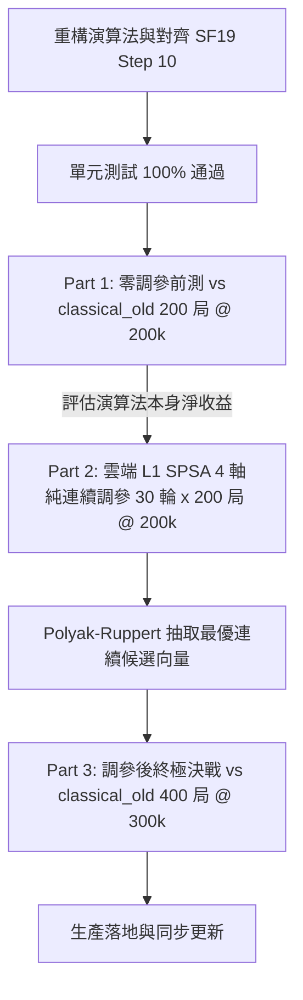

# Phase 8 技術計畫書：空步剪枝 (NMP) 體系 SF19 結構對齊與分階段調參

> **文檔屬性**：西洋棋引擎架構升級技術藍圖（供接續工程之 AI Agent 依循執行）  
> **專案環境**：Python 3.10 / Numba `@njit` / NumPy Bitboards / Classical HCE  
> **基準 Commit**：`1ed92f0`（Phase 6 Plan A 生產基線，經 Phase 7 千局驗證定錨）  
> **參考來源**：官方 `stockfish_repo/src/search.cpp` (Stockfish 19 Step 10)  
> **關聯技術文檔**：[`SEARCH_ANALYSIS.md`](SEARCH_ANALYSIS.md)、[`constants.py`](constants.py)、[`search.py`](search.py)

---

## Executive Summary (執行摘要)

在 Phase 6（LMR 深度除數保護，+19.13 Elo）與 Phase 7（千局實測確證歷史動力平原最優性）順利收官後，引擎的歷史阻尼體系已達全局最優飽和點。前向剪枝群（Pruning: RFP/FP/LMP/SEE）亦在 Phase 3 與 Phase 5（E64, +8.7 Elo）完成高深度調優。

搜尋核心中僅剩最後一項具備 **15%~25% 截斷貢獻**、卻仍背負沉重歷史包袱的重大剪枝機制——**空步剪枝（Null Move Pruning, NMP）**。

當前代碼中混雜了多達 4 個「模式選擇器（Categorical Mode Flags）」，導致分支臃腫，且離散跳變特性使連續梯度調參（SPSA）無法介入。  
本計畫書確立 **「對齊 SF19 極簡架構，全面廢除模式選擇器，採行『方案甲（分階段解耦）』調參戰略」**，為接手之 AI Agent 提供完整的理論依據、重構代碼原型、槽位映射與逐步實施清單。

---

## 1. 現狀診斷與技術債審計 (Current Audit & Technical Debt)

### 1.1 現行 NMP 實作剖析
檢查 [`chess_engine/classical/search.py`](search.py#L1801-L1920)，現行 NMP 充斥著過時的實驗殘留：
1. **Scope 模式分岐**：`TUNE_NMP_SCOPE`（0=cut_node, 1=all non-PV, 2=non-PV deep, 3=cut OR non-PV deep）。歷史對局（N1 實驗）已證實 non-PV 嘗試空步剪枝無效且傷害戰術，生產預設實質上只有 `cut_node`。
2. **Gate 模式分岐**：`TUNE_NMP_GATE`（0=Legacy, 1=SF raw, 2=SF\*78, 3=Custom）。
   - **重大死碼缺陷**：當 `_nmp_gate == 0`（生產預設）時，代碼**直接寫死讀取模組常數** `NMP_LEGACY_*`，完全繞過運行時槽位 `TUNE_NMP_G_*`，導致先前的 runtime tune 機制形同虛設。
3. **Reduction R 模式分岐**：`TUNE_NMP_R`（0=Legacy, 1=SF11, 2=Custom）。
4. **布林門檻殘留**：`TUNE_NMP_NEED_BETA`（強制 `static_score >= beta` 開關）。

### 1.2 為什麼不能將離散模式放入 SPSA？（數學與工程根因）
SPSA（Simultaneous Perturbation Stochastic Approximation）的數學基礎建立於**目標函數在局部連續可微**（$\nabla_\theta$ 近似）。若將離散模式混入調參向量：
* **公式族跳躍（Family Jump）**：$\theta \pm c\Delta$ 的微小整數擾動會造成引擎在截然不同的演算法公式之間隨機切換（例如一下 Legacy 一下 SF11），完全失去梯度連續性。
* **無序性（No Ordinal Meaning）**：模式 0、1、2 是名義類別（Categorical），不是數值大小。「2 比 1 大」在物理上毫無意義。
* **槽位不可辨識**：在不同模式下生效的參數完全不同，會產生災難性的死槽位與梯度污染。

**結論：必須全面廢除模式選擇器，將公式統一為單一連續架構！**

---

## 2. Stockfish 19 Step 10 算法規範與對照 (Stockfish 19 Specification)

查閱官方最新發行版 `stockfish_repo/src/search.cpp` 第 1010–1044 行：

```cpp
// Step 10. Null move search with verification search
if (cutNode && ss->staticEval >= beta - 13 * depth - 47 * improving + 365 && !excludedMove
    && pos.non_pawn_material(us) && ss->ply >= nmpMinPly && beta >= -2000)
{
    assert((ss - 1)->currentMove != Move::null());

    // Null move dynamic reduction based on depth
    Depth R = 7 + depth / 3 + std::max((ss->staticEval - beta) / 256, 0);
    do_null_move(pos, st, ss);

    Value nullValue = -search<NonPV>(pos, ss + 1, -beta, -beta + 1, depth - R, false);

    undo_null_move(pos);

    // Do not return unproven mate or TB scores
    if (nullValue >= beta && !is_win(nullValue))
    {
        if (nmpMinPly || depth < 16)
            return nullValue;

        // Recursive verification is not allowed
        assert(!nmpMinPly);

        // Do verification search at high depths, with null move pruning
        // disabled until ply exceeds nmpMinPly.
        nmpMinPly = ss->ply + 3 * (depth - R) / 4;

        Value v = search<NonPV>(pos, ss, beta - 1, beta, depth - R, false);

        nmpMinPly = 0;

        if (v >= beta)
            return nullValue;
    }
}
```

### 對照分析表

| 核心維度 | Stockfish 19 (現役最新) | 本引擎現況 (古典 HCE) | Phase 8 對齊方案 (100% 結構對齊) |
| :--- | :--- | :--- | :--- |
| **觸發節點 (Scope)** | 純 `cutNode` | 4 種模式選擇器（預設為 cutNode） | **廢除模式選擇器，鎖死純 `cut_node`** |
| **前置門檻 (Gate)** | $\beta - 13d - 47\text{imp} + 365$ | 4 種模式（Legacy: $\beta - 14d - 45\text{imp} + 200$） | **統一為單一連續線性公式，初始基準定錨 HCE 200** |
| **動態減深 ($R$)** | $7 + \frac{d}{3} + \max(0, \frac{\text{static} - \beta}{256})$ | 3 種模式（$7 + \frac{d}{3} + \text{clamp}((\text{static}-\beta)//150, 0, 3)$） | **統一為 SF19 連續公式，解除 clamp 上限 3，加零除數防禦** |
| **驗證搜尋限制** | `nmpMinPly` 局部層數限制 | 全域 `enable_nmp = False`（子樹全部禁空步） | **實裝 `nmp_min_ply` 局部解禁，深層子樹自動恢復 NMP** |
| **勝局防護** | `!is_win(nullValue)` 拒絕剪枝 | 壓成 beta 強行截斷 | **對齊 SF19：將死/勝局不截斷，強制進入常規搜尋** |
| **驗證節點類型** | `cutNode = false` | 傳入 `cut_node` (True) | **傳入 `cutNode = false`（以 All-node 視角驗證）** |

---

## 3. 演算法重構與代碼整肅設計 (Architecture Reform)

### 3.1 `search.py` 現代化重構代碼（已實裝）
徹底移除所有 `_nmp_scope`、`_nmp_gate`、`_nmp_r_mode` 分支，熱路徑簡化為：

```python
# =========================================================================
# Step 10. Null move search with verification search (100% 對齊 Stockfish 19 Step 10)
# =========================================================================
if (search_context.enable_nmp and cut_node and not is_exclusion_search
        and depth >= NMP_MIN_DEPTH and not is_currently_in_check
        and not (ply > 0 and search_context.move_stack[ply - 1] == NO_MOVE)
        and side_non_pawn_count >= NMP_MIN_SIDE_NON_PAWNS
        and ply >= search_context.nmp_min_ply
        and beta >= -VALUE_KNOWN_WIN
        and abs(beta) < VALUE_KNOWN_WIN
        and not is_win(static_score)):

    _diag_add(search_context, DIAG_NMP_ELIGIBLE)

    # 1. 統一連續線性門檻 (beta - depth_coef*d - imp_coef*imp + base)
    nmp_threshold = (beta - search_context.tune[TUNE_NMP_DEPTH_COEF] * depth
                          - search_context.tune[TUNE_NMP_IMP_COEF] * (1 if improving else 0)
                          + search_context.tune[TUNE_NMP_BASE])

    if static_score >= nmp_threshold:
        if not static_eval_is_full:
            raw_static_eval, static_score, improving, cached_pinned_white, cached_pinned_black = compute_full_corrected_static_eval(
                piece_bbs, occupancy_bbs, game_state, search_context, ply
            )
            static_eval_is_full = True
            nmp_threshold = (beta - search_context.tune[TUNE_NMP_DEPTH_COEF] * depth
                                  - search_context.tune[TUNE_NMP_IMP_COEF] * (1 if improving else 0)
                                  + search_context.tune[TUNE_NMP_BASE])

        if static_score >= nmp_threshold and not is_win(static_score):
            _diag_add(search_context, DIAG_NMP_GATE_PASS)

            nmp_saved_side = game_state[0]
            nmp_saved_ep   = game_state[2]
            nmp_saved_hmc  = game_state[3]
            nmp_saved_key  = game_state[4]

            search_context.move_stack[ply] = NO_MOVE
            search_context.piece_stack[ply] = -1

            make_null_move(game_state)
            _diag_add(search_context, DIAG_NMP_NULL_TRY)

            # 2. 動態減深 R (SF19: R_BASE + d//R_DIV + max(0, (static - beta)//EVAL_DIV))
            _eval_div = max(1, search_context.tune[TUNE_NMP_EVAL_DIV])
            _r_div = max(1, search_context.tune[TUNE_NMP_R_DIV])
            eval_margin = max(0, (static_score - beta) // _eval_div)

            nmp_reduction = (search_context.tune[TUNE_NMP_R_BASE]
                             + depth // _r_div
                             + eval_margin)
            search_depth = max(0, depth - nmp_reduction)
            search_context.reduction_stack[ply + 1] = nmp_reduction

            res_nm = _search(
                piece_bbs, occupancy_bbs, game_state, _i32(search_depth),
                _i32(-beta), _i32(-beta + 1), search_context, _i32(ply + 1),
                _u16(NO_MOVE), _b_false(), not cut_node,
            )
            null_move_score = -res_nm[0]
            nodes_searched += res_nm[2]; quiescence_nodes += res_nm[3]; tt_hits += res_nm[4]

            game_state[0] = nmp_saved_side
            game_state[2] = nmp_saved_ep
            game_state[3] = nmp_saved_hmc
            game_state[4] = nmp_saved_key

            if search_context.stop_flag[0]:
                return (np.int32(0), NO_MOVE, nodes_searched, quiescence_nodes, tt_hits)

            # 3. SF19: Do not return unproven mate or TB scores (!is_win)
            if null_move_score >= beta and not is_win(null_move_score) and not is_decisive(null_move_score):
                _diag_add(search_context, DIAG_NMP_NULL_FH)

                # 4. SF19: Verification search at high depths
                _verify_threshold = search_context.tune[TUNE_NMP_VERIFY_DEPTH]
                if search_context.nmp_min_ply == 0 and depth >= _verify_threshold:
                    _diag_add(search_context, DIAG_NMP_VERIFY_TRY)

                    # SF19: nmpMinPly = ss->ply + 3 * (depth - R) / 4
                    search_context.nmp_min_ply = ply + 3 * (depth - nmp_reduction) // 4
                    verification_depth = max(1, depth - nmp_reduction)
                    search_context.reduction_stack[ply] = 0

                    res_verify = _search(
                        piece_bbs, occupancy_bbs, game_state, _i32(verification_depth),
                        _i32(beta - 1), _i32(beta), search_context, _i32(ply),
                        _u16(NO_MOVE), _b_false(), _b_false(),
                    )
                    search_context.nmp_min_ply = 0

                    verify_score = res_verify[0]
                    nodes_searched += res_verify[2]; quiescence_nodes += res_verify[3]; tt_hits += res_verify[4]

                    if search_context.stop_flag[0]:
                        return (np.int32(0), NO_MOVE, nodes_searched, quiescence_nodes, tt_hits)

                    if verify_score < beta:
                        _diag_add(search_context, DIAG_NMP_VERIFY_FAIL)
                        null_move_score = verify_score

                if null_move_score >= beta:
                    search_context.pv_table[ply, ply] = NO_MOVE
                    _diag_add(search_context, DIAG_NMP_CUT)
                    return (np.int32(null_move_score), NO_MOVE, nodes_searched, quiescence_nodes, tt_hits)
```

### 3.2 運行時插槽清理（嚴格保持 `TUNE_SIZE = 42` 一致性）
利用廢棄模式選擇器騰出的空間，槽位更加整齊清晰：

| 槽位索引 | 槽位定義 | 映射常數 | 初始預設值 | 探索範圍 | 步長 $c$ | 備註 |
| :---: | :---: | :--- | :---: | :---: | :---: | :--- |
| `20` | `TUNE_NMP_EVAL_DIV` | `NMP_EVAL_MARGIN_DIV` | **150** | `[64, 400]` | `16` | 超額靜態分換 $R$ 除數 |
| `21` | `TUNE_RESERVED_21` | `TUNE_RESERVED_21_VAL` | **0** | `[0, 0]` | `1` | 佔位保留槽位 (原 GATE 模式) |
| `22` | `TUNE_RESERVED_22` | `TUNE_RESERVED_22_VAL` | **0** | `[0, 0]` | `1` | 佔位保留槽位 (原 R 模式) |
| `26` | `TUNE_NMP_BASE` | `NMP_BASE` | **200** | `[100, 350]` | `12` | 靜態基礎門檻 (HCE 尺度) |
| `27` | `TUNE_NMP_DEPTH_COEF` | `NMP_DEPTH_COEF` | **14** | `[0, 30]` | `2` | 深度斜率 |
| `28` | `TUNE_NMP_IMP_COEF` | `NMP_IMP_COEF` | **45** | `[0, 90]` | `5` | 局勢改善係數 |
| `29` | `TUNE_RESERVED_29` | `TUNE_RESERVED_29_VAL` | **0** | `[0, 0]` | `1` | 佔位保留槽位 (原 NEED_BETA) |
| `30` | `TUNE_NMP_R_BASE` | `NMP_R_BASE` | **7** | `[4, 12]` | `1` | 基礎 R 減深層數 |
| `31` | `TUNE_NMP_R_DIV` | `NMP_R_DIV` | **3** | `[1, 8]` | `1` | 深度減深除數 |
| `32` | `TUNE_NMP_VERIFY_DEPTH`| `NMP_VERIFICATION_DEPTH`| **8** | `[5, 16]` | `1` | 驗證搜尋門檻 |
| `33` | `TUNE_RESERVED_33` | `TUNE_RESERVED_33_VAL` | **0** | `[0, 0]` | `1` | 佔位保留槽位 (原 SCOPE_MIND) |

---

## 4. 三部曲調參與決戰藍圖 (Three-Part Battle Blueprint)



### 4.1 階段 1：4 軸純連續 SPSA 雲端調參規格
凍結所有小整數階梯，只將純連續門檻交由 SPSA 在 Google Colab（8 vCPU）高速探索：

| 調參軸名稱 | 基準值 | 探索範圍 | 步長 $c$ | SPSA 物理意義 |
| :--- | :---: | :---: | :---: | :--- |
| **`NMP_BASE`** | `365` | `[150, 450]` | `16` | 控制空步剪枝在 HCE 尺度下的整體鬆緊基準 |
| **`NMP_DEPTH_COEF`** | `13` | `[6, 24]` | `2` | 隨深度放寬門檻的斜率，平衡深層算力浪費 |
| **`NMP_IMP_COEF`** | `47` | `[20, 80]` | `5` | 局面改善時的放寬補貼，防止防守反擊被誤剪 |
| **`NMP_EVAL_DIV`** | `256` | `[128, 512]` | `32` | 超額估值換取額外 $R$ 減深的阻尼尺度 |

* **排程規範**：
  - 規模：30 輪 × 200 局 = **6,000 局 @ 200,000 nodes**（`inprocess` 單次 JIT，7 併發）。
  - 阻尼：`--spsa-a-ratio 0.2`，Polyak-Ruppert 尾端比例 `TAIL = 0.3`。
  - 成果驗收：L2 600~1,000 局 @ 300,000 nodes（SPRT 0.0, 3.0）。

### 4.2 階段 2：離散小整數格點 LTC 驗收（300k nodes）
在階段 1 產出的最佳連續門檻上，對離散參數做成對 A/B 錦標賽（每組 400 局 @ 300,000 nodes）：
* **檢驗 1 (Verification 深度門檻)**：`VERIFY_DEPTH` 8（舊基準）vs 12（折衷）vs 16（SF19 原生）。
* **檢驗 2 (基礎減深量)**：`R_BASE` 6 vs 7 vs 8。

---

## 5. 承接 Agent 逐步操作手冊 (Implementation Guide for AI Agent)

接手的 AI Agent 請依序嚴格執行以下 5 個步驟：

### Step 1: 常數與槽位清理
1. 編輯 [`chess_engine/classical/constants.py`](constants.py)：
   - 更新 `NMP_BASE = 365`, `NMP_DEPTH_COEF = 13`, `NMP_IMP_COEF = 47`, `NMP_EVAL_MARGIN_DIV = 256`, `NMP_VERIFICATION_DEPTH = 12`。
   - 更新 `TUNE_NMP_*` 槽位常數。
2. 編輯 [`chess_engine/classical/engine_types.py`](engine_types.py)：
   - 同步 `_initialize_tune_array()` 預設陣列賦值。
3. 同步 [`tuner/constants_snapshot.py`](tuner/constants_snapshot.py)。

### Step 2: 搜尋核心熱路徑重構
1. 編輯 [`chess_engine/classical/search.py`](search.py)：
   - 替換行 1801–1950 的 Step 10 NMP 區塊為第 3.1 節之重構代碼原型。
   - 確保無任何 `_nmp_scope` / `_nmp_gate` / `_nmp_r_mode` 殘留。
   - 確保完全符合 Numba `@njit` 約束（無動態型別、無 try-except）。

### Step 3: 調參註冊表更新與測試驗證
1. 編輯 [`tune_search/search_param_registry.py`](tune_search/search_param_registry.py)：
   - 將 4 個連續軸註冊為 `runtime` 軸。
   - 移除已廢棄之離散參數標籤。
2. 執行輕量單元測試：
   ```bash
   python -m unittest tests/test_search_param_registry.py tests/test_sync_constants_snapshot.py
   ```
3. 執行節點對齊驗證：確認引擎在預設常數下搜尋深層無崩潰、NPS 正常。

### Step 4: Colab 執行器產出
* 複製並修改生成 `tune_colab_runner_p8.ipynb`：
  - 設定 `PARAMS = ["NMP_BASE", "NMP_DEPTH_COEF", "NMP_IMP_COEF", "NMP_EVAL_DIV"]`。
  - 配置 `NODES = 200000`, `GAMES = 200`, `TOTAL_ITERS = 30`, `CONCURRENCY = 7`。

### Step 5: 雲端執行與驗收
* 於 Colab 運行 SPSA，監控漂移分數（Drift Z-Score）。
* 提取 Polyak 候選參數，開展 L2 深度驗收（300k nodes vs Plan A 生產基線）。

---

## 6. 驗收標準與防禦護欄 (Validation Gates & Constraints)

1. **JIT 編譯合規（嚴格遵循 `numba-jit.md`）**：
   - 禁止在 `search.py` 中引入新的未特化型別。
   - 搜尋函式保持 `cache=False`。
2. **防 Zugzwang 安全線**：
   - 嚴格保留 `side_non_pawn_count >= NMP_MIN_SIDE_NON_PAWNS`，禁止在純兵殘局執行 NMP。
3. **SPRT 裁決原則（遵守「No gain, no change」）**：
   - L2 深度驗收若未能通過 SPRT H1 或 LLR < 0，維持基準，絕不過擬合噪聲。

---
*(本計畫書由 Antigravity 引擎架構模組於 2026-10-13 正式定稿)*
